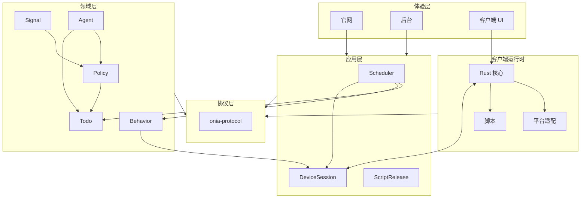

# Onia 技术架构

本文是 Onia 的架构成稿。管线继承现有 SP 的 **Signal（事实）→ Todo（决策）→ Behavior（执行）**，但把协议、分层和模块边界收紧：一份契约、一层只做一层的事、模块职责互不穿透。文档只维护在 colna-memo，不使用飞书。不复用、不迁入公司私有代码或内部接口。

## 已定决策

- **仓库**：GitHub **私有**（命名约定 `github.com/colna/onia`，未创建前仅作约定）。
- **数据库**：**PostgreSQL** 为唯一业务主库。账号、设备、Signal / Todo / Behavior、入站消息、回复草稿、审计与脚本清单都落在 PostgreSQL；不用 SQLite 或其它库做主存储。访问用 `sqlx`，schema 变更只走 `sqlx migrate`，且必须向前兼容。媒体文件走对象存储，不进数据库。

其余未确认项见文末，实现按下列假设推进，产品定义若不同再改。

## 假设

1. Onia 是个人项目的 Social Proxy：本机登录社媒，服务端决策，原设备 WebView 注入脚本执行，结果回传。
2. Agent 处理对方用户的入站消息（首期默认私信）。生成在服务端，发送仍走原设备脚本。默认 **先审后发**，兼支持自动发送与只生成。
3. 客户端先做 Android / iOS（Flutter UI + Rust 核心）；另有官网、后台、脚本，全部放在同一 monorepo。
4. 首期平台 Instagram，协议按多社媒预留，平台只作为字段，不写进类型名。
5. 个人可运维，首期单进程部署。不编造 QPS、延迟、容量或可用性数字。

## 相对现有 SP：继承什么，改掉什么

**保留**

- 三层管线语义：Signal 只记录已发生的事实，Todo 是可调度决策，Behavior 是一次设备执行。
- 设备 WebSocket 长连下发执行，断线或进程冻结时用系统推送叫醒并重连，积压由服务端在重连后推下，不另建一套「拉命令」主路径。
- 脚本是动作真源，经统一入口执行；发送、登录态不出原设备。
- 追踪按 `signal_id → todo_id → behavior_id` 贯通。

**精简与优化（针对现有 SP 已出现的耦合）**

| 现有问题 | Onia 做法 |
|----------|-----------|
| 可下发 Signal 与纯审计/内部事件混在同一组枚举，部分类型派发后无下游 | 拆成 **事实 Signal** 与 **审计 Event**；只有登记了策略的 Signal 才能进入 Todo |
| `TODO_FAILED` 作为 Signal 回灌，重试语义绕回事实层 | 重试是 Todo 状态机的职责，不再发明一种失败 Signal |
| 登录检测等动作绕开主管道，直接派 Behavior | 所有执行都经 Todo → Scheduler → Behavior；需要「禁止自动重试」时在 Todo 策略上声明，不另开暗门 |
| 类型名绑死平台（如按 IG/SC 各写一套） | 协议对象平台中立：`type + platform`，策略按平台注册，不复制一套枚举 |
| 身份字段多套并存、翻译层与脚本易漂移 | 统一身份对象；Behavior 与脚本动作 **1:1**，参数由协议生成，取消手写映射表 |
| 管理端经 BFF 再包一层，出现双层 success、字段前缀不一致 | 无 BFF；后台直连服务端。设备、后台、桥共用 **同一份信封** |
| 决策写在带 I/O 的定义表里，Agent、获客链路、拉消息挤在一起 | **Policy 纯函数模块**：Signal → Todo 计划；Agent、获客剧本是策略包，不进存储层 |
| 调度（promote / 过期 / 能力检查）散落，待办会在执行前过期却责任不清 | **Scheduler 独立模块**：只负责「何时、对哪台设备把 Todo 晋升为 Behavior」 |

## 分层

依赖只能向下。下层不得引用上层类型；同层模块不得直接改对方的表或调用对方的内部函数，只通过协议里的命令与事件协作。

```
体验层          apps/web    apps/admin    apps/client（Flutter UI）
客户端运行时     onia-client-core    native 适配    packages/scripts
适配层          HTTP    WebSocket    PostgreSQL    对象存储    LLM    推送叫醒
应用层          Scheduler    DeviceSession    ScriptRelease    AdminApp
领域层          Signal    Event    Policy    Todo    Behavior    Agent    Identity
协议层          onia-protocol（唯一契约真源）
```



## 协议层

`crates/onia-protocol` 是唯一真源，生成 TypeScript（脚本、后台）和供 Rust 核心使用的类型。Dart/UI 只消费核心命令，不解析原始报文也可以。

### 统一信封

所有 HTTPS、设备长连接、客户端桥，都使用同一信封。禁止各通道再包一层 success，禁止同义字段用不同名字。

```json
{
  "v": 1,
  "kind": "behavior.execute",
  "id": "uuid",
  "trace_id": "uuid",
  "idempotency_key": "string",
  "ts": "RFC3339",
  "payload": {}
}
```

- `v` 是协议版本。新增字段必须可缺省；删改字段升版本。服务端至少兼容当前和上一主版本。
- 写操作必须带 `idempotency_key`；同一键只生效一次。
- `kind` 用点分命名，按层归类，例如 `signal.report`、`todo.promote`、`behavior.execute`、`behavior.result`、`device.hello`、`draft.offer`。

### 稳定身份与能力

```json
{
  "user_id": "onia 用户",
  "device_id": "设备",
  "platform": "instagram",
  "account_id": "平台侧账号稳定 ID",
  "handle": "可选，展示或检索用，不代替 account_id"
}
```

能力用字符串集合，不靠「某个 App 版本一定有某方法」：`inbox.pull.v1`、`inbox.send_reply.v1`、`media.range_download.v1`、`bg_keepalive`。

### 管线对象（精简后）

| 对象 | 含义 | 关键字段 | 谁写谁不写 |
|------|------|----------|------------|
| **Signal** | 已发生的事实 | `type`、身份、`occurred_at`、`source`（device/admin/cron/system）、`payload` | 只追加，不改语义；不直接产生 Behavior |
| **Event** | 审计与观测 | 心跳快照、任务完成附记、告警 | 不进入 Policy，不能被「创建 Signal」入口派发 |
| **Todo** | 决策后的待办 | `type`、`signal_id`、`playbook`、优先级、截止、状态、`attempt`、载荷 | 不与设备通话 |
| **Behavior** | 一次设备执行 | `todo_id`、`device_id`、`action`（= 脚本动作名）、`params`、结果 | 不决定下一步 Todo |
| **ReplyDraft** | Agent 草稿 | `inbound_signal_id`、文案、模式、提示词版本 | 确认后才生成发送类 Todo |

Todo 状态：`pending` / `promoted` / `running` / `succeeded` / `failed` / `cancelled`。取消必须带原因（过期、人工、无能力、已被接管），**设备离线不是失败**。

Signal 类型平台中立，首期最小集：

- `DM_RECEIVED`、`INBOX_ACTIVITY`、`PROFILE_SYNC_NEEDED`、`FUNNEL_COMPLETED`（获客漏斗完成，替代把业务名写进协议核心）
- 通道与平台在字段里：`platform`、`channel`（`dm` / `comment` / …）

策略里登记过的类型才可被 Admin 创建。未登记的类型写入后只作事实存储。

## 领域层：模块职责与禁区

每个模块一张表。禁区是硬约束，CI 可用依赖方向检查来守。

| 模块 | 职责 | 禁区 |
|------|------|------|
| **Identity** | 用户、角色、设备绑定、后台身份 | 不感知 Signal / 脚本 / 模型 |
| **Signal** | 校验、幂等写入事实，向 Policy 发「有新事实」 | 不调用设备、不创建 Behavior、不调 LLM |
| **Event** | 写审计与告警 | 不触发 Todo |
| **Policy** | 纯函数：`Signal + 当前视图 → Todo 计划`。以策略包注册（获客、拉消息、自动回复） | 无 I/O、不访问数据库、不认识 WebSocket |
| **Todo** | 持久化计划、状态机、幂等、重试与放弃 | 不推设备、不改 Signal 语义 |
| **Scheduler** | 按优先级、截止、设备在线与能力，把 Todo 晋升为 Behavior；到期取消 | 不编写业务 if-else（那些在 Policy） |
| **Behavior** | 按 1:1 动作下发、收集结果、写回 Todo 终态 | 不根据结果再「临时决定」新业务动作；若需要下一步，应产生新的 Signal 或交回 Policy |
| **Agent** | 过滤入站、组装上下文、调模型、产出草稿、按模式决定是待审还是生成 Todo | 不持有社媒会话、不直接发消息、不操作 WebView |
| **ScriptRelease** | 清单、签名、灰度、回滚、下发 | 不执行脚本 |
| **DeviceSession** | 握手、能力画像、心跳、推送、断线恢复、叫醒 | 不解释脚本、不跑策略 |
| **Media** | 鉴权后的分片回退，URL 白名单 | 不开放任意 URL 拉取 |

模块之间只传递协议对象。例如 Behavior 完成后若要「拉完新消息再回复」，正确路径是：Behavior 结果 → 产生 `DM_RECEIVED`（或更新会话视图）→ Policy 再产出 `REPLY_DM` Todo；而不是在 Behavior 服务里写死下一步。

### 策略包（Policy）

首期三个包，彼此独立注册：

1. **获客包**：漏斗完成 → 有序列 Todo（例如回关、静音、开场私信），优先级在包内声明。
2. **收件箱包**：`INBOX_ACTIVITY` → `PULL_INBOX`。
3. **回复包**：`DM_RECEIVED` →（可选门控 Todo）→ Agent 生成草稿或 `SEND_REPLY` Todo。默认模式 `review`。

新增业务先加策略包，不改 Scheduler、不改设备协议。

### Agent

仍是「决策辅助」，不是执行器。链路保持精简：

1. 设备上报入站事实（`DM_RECEIVED`，幂等键 = `platform + message_id`）。
2. 回复包调用 Agent：过滤自己发出的、已回复的、接管中的、超限的。
3. 用版本化人设 + 安全策略 + 会话摘要调用 LLM（OpenAI 兼容，密钥只在服务端）。入站文本当数据字段，不拼进系统指令。首期 **无工具调用**，只输出结构化草稿。
4. `review`：推待审；通过或改写后再建 `SEND_REPLY` Todo。`auto`：过安全检查后建 Todo。`suggest`：只留草稿。
5. 人工接管或发送失败（会话/风控）：取消未发出的发送 Todo，该会话不再自动发。

模型失败不向对方发空白或错误文案；`auto` 遇安全/解析失败降级为待审。

## 应用层与适配层

首期 **一个 Rust 二进制** 承载全部服务端模块，目录按模块切开，进程先不拆。

- 设备 HTTPS：登录、绑定、清单、媒体回退、草稿确认。
- 设备 WebSocket：下发 `behavior.execute`、脚本版本、待审草稿；上送 hello、心跳、`signal.report`、`behavior.result`、接管。
- 后台 HTTP：直连 AdminApp，独立鉴权，不经 BFF。
- PostgreSQL：业务状态与追踪的权威存储。
- 对象存储：媒体。
- LLM：仅 Agent 经适配器调用。
- 推送叫醒：仅在连接断开或进程冻结时唤醒设备重连，不承载命令正文。

建议实现栈：`axum` + `tokio` + `sqlx` + PostgreSQL。不要同时引入多种 Web 框架。

## 客户端运行时与体验层

**推荐**：Flutter UI + Rust 核心（FFI）+ 系统 WebView。热路径（协议、状态机、脚本缓存、媒体 Range、连接）在 Rust；UI 只是投影。不采用 RN、不把 Tauri 当正式移动端、不做双端原生 UI（个人维护成本过高）。

```
apps/client            Flutter：导航、设置、待审回复、任务可见状态
crates/onia-client-core    协议、状态机、缓存、连接（权威状态）
apps/client/native/*   仅平台差异：前台服务、iOS 后台约束、Cookie / WebView、叫醒
packages/scripts       TypeScript 真源；产物 OTA 下发
```

脚本统一入口 `SocialProxy.execute(action, params)`。运行时由宿主注入 `api_base`、版本、能力、`trace_id`，构建物禁止写死环境地址。与自动回复相关的动作（`pull_inbox`、`send_reply`、`check_thread`）也是普通 Behavior，脚本不调 LLM。

执行规则：昂贵动作前做真实会话校验；鉴权与风控失败不重试；错误分层为 `session` / `platform_risk` / `network` / `script` / `host`。

**官网**（`apps/web`）：静态站点，介绍与下载，不登录、不发任务。

**后台**（`apps/admin`）：设备与能力、Signal/Todo/Behavior 追踪、脚本发布回滚、Agent 人设与待审、手动创建（仅已登记）Signal。

iOS 后台能力弱于 Android：靠 DeviceSession 上报的 `runtime` 与能力，Scheduler 不把必须前台的 Todo 派到受限设备上。

## 失败回退、兼容与发布

| 失败 | 回退 |
|------|------|
| 脚本下载或校验失败 | 沿用已校验的本地/内置版本 |
| 媒体直连失败 | 鉴权后的服务端分片；仍失败则该 Behavior 失败，是否重试由 Todo 策略声明 |
| 长连接断开 | 设备重连并对账；不重放已成功 Behavior；积压由 Scheduler 再推 |
| 缺能力 | 该 Todo 等待或取消（记无能力），不把离线写成失败 |
| 模型不可用或草稿不合法 | 不发送，保留事实与待审 |
| 会话失效或平台风控 | 不重试，标记需在本机重新登录 |

发布顺序：协议（向后兼容）→ 服务端（含 Agent）→ 脚本（可灰度、可回滚）→ 后台/官网 → 客户端商店包。破坏性桥变更必须双写至少一个发布周期。Agent 提示词按版本回滚；紧急情况把账号从 `auto` 降为 `review` 或关闭。

## Monorepo

按层落目录，不按「临时功能」散落：

```
onia/
  crates/
    onia-protocol/         # 协议层
    onia-signal/           # 领域：事实
    onia-policy/           # 领域：纯策略包
    onia-todo/
    onia-behavior/
    onia-agent/
    onia-identity/
    onia-scheduler/        # 应用层
    onia-device/
    onia-server/           # 组装与适配（HTTP/WS/DB/LLM）
    onia-client-core/      # 客户端运行时核心
  apps/
    server/                # 二进制入口
    client/                # Flutter + native
    web/
    admin/
  packages/
    scripts/
    protocol-ts/           # 生成物，勿手改
  justfile                 # gen / test / build
```

依赖规则写进 workspace：`onia-policy` 不得依赖 `onia-server` / `onia-device`；`onia-signal` 不得依赖 `onia-behavior`；生成物必须与协议无脏 diff。密钥、会话、模型 API Key 不入库。仓库 README 只写如何构建，架构以本文件为准。

工具：`just` + Cargo + pnpm。Flutter 与 Rust 核心建议先用 `flutter_rust_bridge`。

## 分批落地

**P0** 管线打通：协议生成、PostgreSQL 迁移、设备握手、人工创建一个已登记 Signal → Policy → Todo → Behavior → 脚本执行 → 结果回写；后台能看追踪。

**P1** 能用：脚本 OTA、媒体 Range 与鉴权回退、Scheduler 过期与幂等、私信上报、Agent 先审后发。

**P2** 完整策略与多端：iOS 能力降级、第二平台（只加策略与脚本，不改信封）、`auto` / `suggest`、限流与人工接管、官网、脚本灰度。

**P3** 可选：桌面调试宿主、必要时再拆进程、受控工具调用（需单独允许列表）。

## 待确认

1. 是否还要独立创作者工作台（内容库、日历、分析），还是先就是「容器 + 管线 + 自动回复」？
2. 首期是否必须同时出 iOS，还是 Android 先闭环？
3. 第一个平台是否 Instagram？自动回复首期是否只做私信？
4. 仓库是否就用私有的 `github.com/colna/onia`？
5. 部署用单 VPS 还是 Fly/国内云？对象存储与 LLM 供应商各用哪家？（数据库已定为 PostgreSQL）
6. 自动回复默认模式是否同意 `review`？

确认后可以把假设改为决策，并补一版按信封列出的 P0/P1 接口草表。
