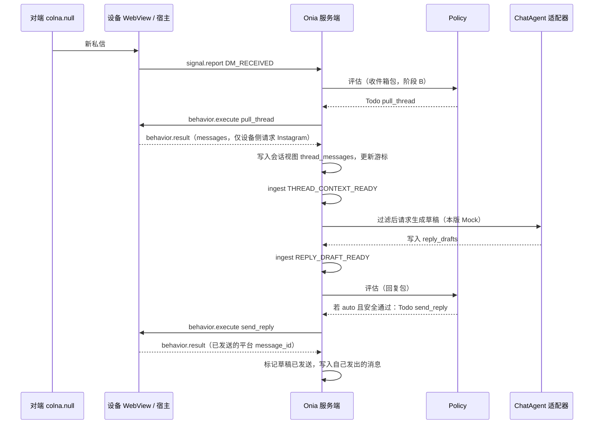

# Onia 收到消息后自动回复（阶段 C）技术方案

本文把 [instagram-dm-sync.md](instagram-dm-sync.md) 里的阶段 C（回复包 / Agent）落到可实现的闭环：新消息监听 → 拉聊天记录 → 处理聊天记录 → 请求聊天 Agent → 发送。只出方案和假设，不改 Onia 或 sitin-next 仓库。本稿已按 Code Reviewer 对 HEAD `f636fccc` 的评审意见修订；这三处必须改复核通过后再交 Coder，此前不进入开发。

## 结论

1. **闭环必须继续走「事实 / 视图更新 → Policy 再产出 Todo」，禁止在 Behavior 里写死「拉完再回复」。** 阶段 B 的 `DM_RECEIVED` → `pull_thread` 保持不变。`pull_thread` 成功后，服务端把 `behavior.result` 里的消息写入会话视图，再 ingest 系统 Signal；回复包这才调用 Agent、写入 `reply_drafts`，并由 Policy 按模式决定是否产出 `send_reply`。
2. **本版本实现 `review` / `auto` / `suggest` 三条分支，账号级可切换；架构默认仍是 `review`，不丢掉先审后发。** 为跑通「把发送纳入闭环」，测试账号本版本使用 `auto`，用 mock 文案真机发出。真实聊天 Agent 放到下个版本，只替换适配器，不改管线。
3. **接通已有的 `onia-agent` crate 和 `reply_drafts` 表，不另起平行管线。** 本版本适配器是 Mock：从 `['hi','how are u','u?','im good']` 随机取一条（这 4 个字符串保持原样）。Mock 不得写进 `send_reply` 脚本或 Behavior。
4. **`send_reply`、`send_message`、`send_greet` 保持三个动作。** `send_reply` 复用已有的导航 / 输入 / 发送帮手，但契约、Todo 类型、能力名、是否允许手动创建都分开。控制台手动创建 `send_reply` 继续拒绝。打招呼回归走既有「关注 + 打招呼」，不走回复包。
5. **硬约束不变：** 所有对 Instagram 域名或其 CDN 的请求只能由设备客户端发出。服务端只调度、存游标 / 事实 / 会话视图、校验并收 `behavior.result` / `signal.report`，不得持 cookie 或 session，不得反向代理 GraphQL / 私有接口，也不得直接去 Instagram 取媒体。
6. **不要回退阶段 A/B。** 空参 `pull_thread`、监听短动作、规范 `thread_id` / 游标、登录探测与工作台展示保持现行为。上轮未稳定观察到 `DM_RECEIVED`，本版本在弱事件路径上补：`INBOX_ACTIVITY` → `pull_inbox` 之后，对未读会话**先按阶段 B 别名规则归一成规范 `thread_fbid`**，再产出 `pull_thread`（不编造 `message_id`，不把 Direct v2 id 或 `thread-unknown-*` 直接当规范键）。`THREAD_PULL_NEEDED` 的 ingest 幂等键不能是永久的 `platform + account_id + thread_id`。
7. **把 Todo 去重从「整用户按类型」改为「按会话 / 入站」时，必须同时改既有的 `dm_received_pack` 和 `thread_sync_continue_pack`，不能只给新回复包扩展 `PolicyView`。** 否则会话 A 有一条未完成 `pull_thread` 时，会话 B 的 `DM_RECEIVED` / `THREAD_PULL_NEEDED` 仍会被现码 `already_open(TODO_PULL_THREAD)` 整用户吞掉。`INBOX_ACTIVITY → pull_inbox` 可继续按类型去重；`manual_pack` 仍不做类型级去重。

## 本次修订（2026-11-13）

主路径不改，仍走「事实 / 视图更新 → Policy 再产 Todo」。下面三条是必须落实的修订，细节见后文对应小节；评审中的建议项也已一并写入，不另开文档。

1. 弱事件路径先把收件箱会话键归一成 `thread_fbid`，解析不到或 `thread-unknown-*` 的未读会话跳过，必要时扩展 `InboxThread`，禁止把 v2 id 直接塞进 `pull_thread`。
2. `THREAD_PULL_NEEDED` 按「该会话已有进行中的 `pull_thread` 则不再下发」做应用层去重；ingest 幂等键带上本次 `pull_inbox` 的 `behavior_id`，避免同一会话后续未读被旧键吞掉。
3. 扩展 `PolicyView` 的同时改 `dm_received_pack`、`thread_sync_continue_pack`（以及新的弱路径 / 回复包），不要把按会话去重只留给新代码。

## 与既有文档的关系

- [architecture.md](architecture.md) 仍然有效：Policy 纯函数、Agent 不持有社媒会话、不直接发消息；「拉完再回复」必须形成新的事实或更新会话视图后再交给 Policy。回复包默认模式 `review`，兼支持 `auto` 与 `suggest`。原文「Agent 按模式决定是否生成 Todo」与本文不一致，**以本文为准**：Agent 只写 `reply_drafts`，Policy 在 `REPLY_DRAFT_READY` / `REPLY_DRAFT_APPROVED` 之后才决定是否产出 `send_reply`。架构文档已同步改了这一处表述。本文是把这些原则落到阶段 C 的实现方案，不是改掉它们。
- [instagram-dm-sync.md](instagram-dm-sync.md) 的阶段 A/B 结论不改。本文只展开原先「后续」的阶段 C。
- [instagram-actions-pipeline.md](instagram-actions-pipeline.md) 已区分 `send_message` / `send_greet`，并预留 `inbox.send_reply.v1` 且明确不与运营发令混用。本文接通 `send_reply`，不合并这三个动作。
- 现码（只读，未提交工作树 `/Users/colna/WORK/onia`）：`DM_RECEIVED` 只产出 `pull_thread`；`onia-agent` 仍是 P0 桩（`p0_enabled() == false`，已声明 `review` / `auto` / `suggest`）；`reply_drafts` 已在 `0001_init.sql` 建表，字段尚未够用；协议里已有能力名 `inbox.send_reply.v1`，但还没有 `send_reply` 动作目录、`TODO_SEND_REPLY`，手动 payload 会被拒绝；`send_message` / `send_greet` / `follow_user` 脚本与目录已存在；客户端尚未上报 `inbox.send_reply.v1`。`onia-server` 已依赖 `onia-agent`，应接通而不是新开 crate。

对照 sitin-next 时只读查看，没有切换分支或改工作树。当前工作树在 `feature/pwa_pc_rebased`（`packages/business-pwa-proto/proto` 有未提交改动，与本方案无关）。脚本对照以本地 `feature/sp-ig-dm-api` 与工作树已有实现为准：`sendMessage.js` 是「导航到会话、输入并发送、发送前 / 后检测对方新消息，必要时调用 `getChatMessages`」的 pipeline；`sendGreet.js` 以对方主页为基准，点「发消息」、输入、发送后回收件箱。公司身份字段（`womanSocialId` / `manSocialId` / `creatorId`）和 `AndroidBridge` 不迁入 Onia。GitLab MR 1462 的远程 refs 本次 `git ls-remote` 无响应，见文末假设。

## 硬约束：Instagram 请求只出设备

与阶段 A/B 同一条硬约束，覆盖本版本的拉消息、发送前检测、发送本身，以及媒体：

- GraphQL、私有 HTTP、页面内发送、发送前检查对方是否有新消息，全部在设备 WebView 脚本或本机宿主发出。
- 服务端不得代发、不得反向代理 Instagram GraphQL / 私有接口，不得持有 cookie / session 去打 Instagram。
- 若消息附件要进对象存储，由客户端本机拉取后再上传；服务端不得直接请求 Instagram / CDN URL。
- Agent 只消费已经落在 PostgreSQL 会话视图里的文本和元数据，不自己去平台拉上下文。

## 本版本采用哪种模式，以及下个版本怎么切

架构默认回复模式仍是 **`review`（先审后发）**。本版本必须把三条模式都接到同一条管线上，而不是只做自动发送：

| 模式 | 本版本行为 | 下个版本（真实 Agent） |
|------|------------|------------------------|
| `review` | 写入 `reply_drafts`，状态为待审；后台（本版本最小可用）确认或改写后再 ingest 批准事实，Policy 才产出 `send_reply` | 同一路径，只是草稿来自真实 Agent |
| `auto` | 草稿通过安全检查后，Policy 直接产出 `send_reply` 并发送 | 同一路径；安全 / 解析失败仍降级为待审，不向对方发空白或错误文案 |
| `suggest` | 只留草稿，不产出发送 Todo | 同上 |

**为什么本版本测试走 `auto`：** 用户目标是把发送纳入闭环，并用 mock 文案跑通。若测试只走 `review`，在客户端待审界面尚未做完整之前，发送环节可能根本走不到设备上。`auto` 只作为测试账号的运行配置，不是把产品默认改成自动发送。

**配置范围：** 模式挂在平台账号上（建议新表 `account_reply_settings`，不要把字段塞进 `account_bindings` 的职责里）。测试账号 Instagram `24264435413` / `hwangdohyeon165` 本版本设为 `auto`。其它账号若未配置，默认 `review`。会话级人工接管可以让该会话停止自动发送：按 `platform + account_id + 规范 thread_id` 生效，记在会话元数据上（扩 `thread_cursors` 或很薄的 `threads` 表，亦可独立 `thread_takeovers`；字段如 `taken_over` / `taken_over_at` / 原因）。现码还没有按会话落表（后台只有「被接管」文案），本版本要补上。账号级开关与会话接管不要混成一个字段。`PolicyView` 由服务端填入该会话是否已接管。

**一对一判定：** 以 `pull_thread` 的结果为准（参与者数量或脚本回传的 `is_group` / 线程类型，字段名按现码实际回传确定），把判定结果写进上述同一份会话元数据。不要只根据 `pull_inbox` 的 `title` 猜测。无法判定或不是一对一时，本版本不调用 Agent、不发送。

**下个版本切换真实 Agent：** 只替换 `ChatAgent` 适配器实现（由 Mock 换成 LLM），密钥只留在服务端。不改 Signal / Policy / `send_reply` 契约，也不把提示词写进脚本。紧急情况仍可把账号从 `auto` 降为 `review` 或关闭自动回复。

## 端到端时序

主路径（有可靠 `message_id` 的实时监听）：



`review` 在 `REPLY_DRAFT_READY` 之后停下，等后台确认产生 `REPLY_DRAFT_APPROVED` 再产出 `send_reply`。`suggest` 在写入草稿后结束。

弱事件路径（无可靠 `message_id`，或上轮那种 `DM_RECEIVED` 未稳定出现的情况）：

1. 监听报 `INBOX_ACTIVITY` → Policy 产出 `pull_inbox`（已有，不改语义）。
2. `pull_inbox` 成功后，服务端读取结果里的未读会话，**先归一成阶段 B 的规范键 `thread_fbid`，再**为符合条件的会话 ingest 系统 Signal `THREAD_PULL_NEEDED`（不编造 `message_id`，也不伪装成 `DM_RECEIVED`）。
3. Policy 产出 `pull_thread`（参数必须是已经归一的规范 `thread_id`）。
4. 其后与主路径相同：写入会话视图 → `THREAD_CONTEXT_READY` → Agent → 按模式发送。

现码不能直接使用 `pull_inbox` 结果里的 `thread_id`。`packages/scripts/src/actions/pull_inbox.ts` 的 `InboxThread` 目前只有 `thread_id`、`title`、`last_message`、`unread`、`updated_at`；`packages/scripts/src/instagram/inbox.ts` 的 `pullLiveInbox` → `mapThread` 按 Direct v2 取值（`thread_id` / `thread_v2_id` / `id`），缺 id 时写成 `thread-unknown-${index}`，**没有读取或回传 `thread_fbid`**。这与阶段 B 的规范键不是同一个值。若直接拿来做 `THREAD_PULL_NEEDED` 的键、`pull_thread` 参数或 `thread_messages` 唯一键，弱路径会打偏、重复，或对不上 `thread_cursors`。同文件里给 `pull_thread` 用的 `mapResolvedThread` 已经区分 `thread_fbid`、`thread_key` 与 Direct v2 id，弱路径应向这一侧看齐。

处理规则：

- **扩展 `InboxThread`（及 `pull_inbox` 的 `behavior.result`）：** 增加能拿到的 `thread_fbid`、`thread_key`、`ig_direct_thread_id`。一旦能确定规范键，结果里的 `thread_id` 必须是 `thread_fbid`；Direct v2 id 只放在 `ig_direct_thread_id`。`pullLiveInbox` 不应再只打 Direct v2 列表就结束，实现时可复用已有的 GraphQL / 内嵌列表帮手（`listGraphqlInbox` / `mapResolvedThread`）与 Direct v2 结果按别名合并。这只扩展 `pull_inbox` 的结果形状，不改变空参 `pull_thread` 点进可见未读的现行为。
- **服务端在 ingest 之前再按阶段 B 别名规则归一一次：** 结果里的 `thread_fbid` 优先；否则用 `thread_key` / `ig_direct_thread_id` 查 `thread_cursors` 别名，得到规范 `thread_fbid`。
- **跳过无法归一的未读会话：** 包括 `thread-unknown-*`、只有 v2 id 且别名表没有对应项、以及任何解析不到规范键的行。跳过时记审计即可，不要编造规范键，不要把 v2 id 塞进 `pull_thread` 参数，也不要用 `thread-unknown-*` 当游标或 `thread_messages` 主键。下一轮 `pull_inbox`、主路径的 `DM_RECEIVED` 或空参 `pull_thread` 仍可补拉这些会话。

`THREAD_PULL_NEEDED` 的幂等不能用永久的 `platform + account_id + thread_id`。现码 ingest 对同一幂等键会直接返回已有 Signal、不再产 Todo；同一会话第二次未读（弱路径、仍无 `message_id`）会被旧键吞掉。不要编造 `message_id` 来凑键。正确做法分两层：

- **应用层去重（产品语义）：** 该规范 `thread_id` 上已有进行中（`pending` / `promoted` / `running`）的 `pull_thread`，则不要再 ingest，Policy 也不再下发。
- **ingest 幂等键（防同一结果被重放）：** 带上本次成功的 `pull_inbox` 的 `behavior_id`，建议为 `platform + account_id + thread_id + source_behavior_id`。同一条 Behavior 结果被重复 apply 时仍返回已有 Signal；下一次新的 `pull_inbox` 有新的 `behavior_id`，同一会话的新一轮未读不会被吞掉。收件箱预览或 `updated_at` / `last_activity_at` 最多作为辅助观测，不能替代「按进行中的 `pull_thread` 去重」，也不能单独拿来当永久会话键。

截断回补（已有的 `THREAD_SYNC_CONTINUE`）只补更早的历史，**不等待全文同步完成才回复**。只要最新一页里已经有尚未处理的对方消息，就可以进入回复包。

## 事件、Signal、Todo 与动作

| 名称 | 来源 | 本版本 Policy / 编排做什么 | 备注 |
|------|------|------------------------------|------|
| `DM_RECEIVED` | 设备 `signal.report`（实时，有 `message_id`） | 仍只产出 `pull_thread`，**不**直接产出回复 | 幂等键保持 `platform + message_id`；客户端现为 `instagram:<message_id>` |
| `INBOX_ACTIVITY` | 设备 `signal.report`（红点 / 会话列表 / 无 message_id 的实时） | 仍只产出 `pull_inbox` | 不编造 `message_id` |
| `THREAD_PULL_NEEDED` | 系统，来自 `pull_inbox` 结果中已归一到规范 `thread_fbid` 的未读会话 | 产出 `pull_thread`（参数为规范键） | 弱事件衔接；应用层按「该会话已有进行中的 `pull_thread`」去重；ingest 幂等键带本次 `pull_inbox` 的 `behavior_id`；归一失败的行跳过 |
| `THREAD_SYNC_CONTINUE` | 系统，截断拉会话 | 仍产出带游标的 `pull_thread` | 阶段 B 已有，不改 |
| `THREAD_CONTEXT_READY` | 系统，会话视图写入了本轮消息之后 | 不直接产发送 Todo；编排层调用 Agent | 见下一节 |
| `REPLY_DRAFT_READY` | 系统，草稿落库之后 | `auto`：产 `send_reply`；`review` / `suggest`：不产发送 Todo | 安全失败时按 `review` 处理 |
| `REPLY_DRAFT_APPROVED` | 后台确认 / 改写后 | 产出 `send_reply` | 仅 `review`（以及 auto 降级后的待审） |
| `REPLY_DRAFT_REJECTED` | 后台拒绝 | 不产发送；该条入站不再自动发 | 可标记草稿拒绝 |
| `send_reply` / `SEND_REPLY` | 仅 Policy | 设备执行回复 | 新登记动作；禁止手动创建 |
| `send_message` / `SEND_MESSAGE` | 手动 / 发令 | 运营向主动私信 | 本版本不改契约 |
| `send_greet` / `SEND_GREET` | 手动多动作（关注后打招呼） | 从主页打招呼 | 回归用，不走回复包 |
| `follow_user` / `FOLLOW_USER` | 手动多动作第一步 | 关注对方 | 已关注则按现脚本跳过提交 |

`THREAD_CONTEXT_READY` 与 `REPLY_DRAFT_READY` 都不得由设备脚本上报，也不得在 `apply_behavior_result` 里直接 `insert` 发送类 Todo。现码对截断拉会话已采用「成功后再 ingest 系统 Signal」的方式，本版本沿用同一模式。

## 处理聊天记录：会话视图，而不是把正文只留在 Behavior 结果里

「处理聊天记录」是服务端整理与过滤，不是再下一个设备动作，也不是在脚本里调 Agent。

当前 `pull_thread` 的 `behavior.result` 已带 `messages[]`（`message_id`、`direction`：`in` / `out` / `unknown`、`text`、`timestamp`、`sender_fbid`、附件元数据、`thread_id` 等），但服务端只更新 `thread_cursors`，没有把消息持久化为可查询视图。回复包不能每次去翻 Behavior JSON。

本版本新增 `thread_messages` 表（名称可在实现时微调），建议字段：

- 身份：`platform`、`account_id`、规范 `thread_id`（仍以 `thread_fbid` 为准，别名规则与阶段 B 相同）
- 消息：`message_id`、`direction`、`text`、`timestamp`、`sender_fbid`
- 附件：只存客户端已经带回的元数据（例如 kind、URL 字符串），服务端不根据这些 URL 去抓取
- 唯一约束：`(platform, account_id, thread_id, message_id)`

`pull_thread` 成功后：先 upsert 消息和游标，再决定是否 ingest `THREAD_CONTEXT_READY`（幂等键建议 `platform + account_id + thread_id + 本轮最新对方 message_id`）。若本轮没有新的对方消息（例如只拉到自己发出的，或与库中已有记录完全重复），不要反复叫 Agent。

Policy 仍是纯函数，不能自己读库。由 `onia-server` 填一条更完整的 `PolicyView`（以及给 Agent 的上下文）：开放中的 Todo（带类型与规范 `thread_id`，发送类还带 `inbound_message_id`）、账号回复模式、该会话是否接管、已有草稿、尚未回复的对方消息。这与现码 `PolicyView` 只有 `open_todo_types` 不兼容，需要扩展视图，而不是让 Policy 去访问数据库。

### Policy 去重必须同时改既有 pack

现码 `already_open(view, TODO_PULL_THREAD)` 按**整用户 Todo 类型**判断，且已经被 `dm_received_pack` 和 `thread_sync_continue_pack` 使用。若只扩展 `PolicyView`、却把按会话去重留给新的回复包 / `THREAD_PULL_NEEDED`，则会话 A 有一条未完成 `pull_thread` 时，会话 B 的 `DM_RECEIVED`、`THREAD_PULL_NEEDED` 以及另一会话的 `THREAD_SYNC_CONTINUE` 仍会被整用户吞掉。

必须同时改这些 pack（Policy 继续纯函数，只是改它读取的视图字段和判断条件）：

- **`dm_received_pack`、`thread_sync_continue_pack`、以及本版本新增的 `THREAD_PULL_NEEDED` pack：** 只在「同一规范 `thread_id` 上已有进行中的 `pull_thread`」时跳过。空参（没有明确会话键）的进行中 `pull_thread`，只与同样没有明确会话键的拉会话去重，不得挡住已带规范键的其它会话。
- **`inbox_pack`（`INBOX_ACTIVITY` → `pull_inbox`）：** 可继续按类型去重（`already_open(TODO_PULL_INBOX)`），本版本不改这条语义。
- **`manual_pack`：** 必须继续不做类型级去重（现码注释已写明同一 Signal 允许重复下发）。打招呼回归走「关注 + 打招呼」手动多动作，若误加上类型级去重，可能被进行中的自动回复或其它发送 Todo 吞掉。
- **回复包的 `send_reply`：** 按 `inbound_message_id` 去重，同一会话同时最多一条未完成的 `send_reply`。

## Agent 适配器边界（Mock 可替换）

把生成逻辑放在 `onia-agent`，I/O 与适配器装配放在 `onia-server`，与现有职责声明一致：Agent 过滤入站、组装上下文、调用生成器、产出草稿；不持有社媒会话、不直接发消息、不操作 WebView。

建议接口形状（实现时可用 Rust trait，名字可微调，语义必须稳定）：

```text
ChatContext
  platform, account_id, thread_id, target_handle?
  inbound_message_id          # 本轮要对哪条对方消息回复
  inbound_signal_id?          # 能关联则记下，写入 reply_drafts
  messages                    # 来自 thread_messages，按时间排序的近期上下文
  persona / prompt_version    # 本版本 Mock 可忽略；下个版本使用
  mode

ChatAgentDraft
  body
  safety_ok
  adapter_id                  # 本版本：mock_v1
  prompt_version
  inbound_message_id

trait ChatAgent
  generate(ctx: ChatContext) -> Result<ChatAgentDraft, AgentError>
```

本版本唯一实现 **`MockChatAgent`**：从下面这个数组里均匀随机取一条，作为 `body`，`safety_ok = true`，`adapter_id = mock_v1`：

```text
['hi','how are u','u?','im good']
```

这四条字符串必须原样保留，不要改大小写、空格或标点。不要在脚本、Policy 或 `send_reply` 参数默认值里写死这组文案。装配点集中在服务端，下个版本在同一点换成 `LlmChatAgent`（OpenAI 兼容，密钥只在服务端；入站文本当数据字段，不拼进系统指令；首期仍无工具调用，只输出结构化草稿）。

过滤在调用适配器之前做（可放在 `onia-agent` 的纯函数里，便于单测）：

- 自己发出的（`direction = out`，或 `sender_fbid` 等于当前账号的 `viewerEIMU` / 已绑定 `account_id` 能对上的身份）
- `direction = unknown` 且无法证明是对方的，本版本不自动回
- 该 `inbound_message_id` 已有草稿或已有未完成 / 已成功的 `send_reply`
- 该会话处于人工接管
- 自动回复已对该账号关闭

没有通过过滤就不要调用适配器，也不写草稿。写入草稿时，若 `(platform, account_id, inbound_message_id)` 唯一约束冲突，按幂等成功处理：读出已有行，不再次调用 Agent，也不用新正文覆盖已有草稿（已 `sent` / `rejected` / `discarded` 的维持原状；若待审或已批准草稿已在，只保证对应的系统 Signal 不会重复产出发送 Todo）。

`auto` 的「降级为待审」与失败状态要分开，无正文的失败不得变成可批准草稿：

- **`pending_review`（含 `auto` 降级）：** 适配器给出了非空正文，但需要人工确认（例如安全检查未通过、或真实 Agent 标了需审核）。后台可以改写后批准，再 ingest `REPLY_DRAFT_APPROVED`。
- **`failed_safety`：** 安全检查失败，且没有可发出、可编辑的合法正文（空正文，或整段被策略否决）。不可批准，不产 `send_reply`。
- **`failed_generate`：** 生成或解析失败、空返回、适配器异常。不写可批准草稿，不产 `send_reply`。

不得向对方发空白或错误文案。本版本 Mock 几乎总会给出白名单正文且 `safety_ok = true`；这条状态机是为了接通三种模式，并给下个版本的真实 Agent 留好边界。

### 接通 `reply_drafts`，不要新开一套表替代它

现表只有 `id`、`inbound_signal_id`、`body`、`mode`、`prompt_version`、`created_at`，不够支撑闭环。用新的向前兼容 migration **扩列**，不要另建平行草稿表。建议补齐：

- `user_id`、`platform`、`account_id`、`thread_id`
- `inbound_message_id`（与账号、平台一起唯一，作为回复幂等核）
- `adapter_id`、`safety_ok`
- `status`：`pending_review` / `approved` / `rejected` / `sent` / `discarded` / `failed_safety` / `failed_generate`
- `send_todo_id`、`updated_at`、`reviewed_at`
- 可选：改写后的正文（`review` 时允许人工改后再发）

`inbound_signal_id` 能关联到原始 `DM_RECEIVED` 就保留；弱事件路径可能没有对应的 `DM_RECEIVED` 行，允许为空，但 `inbound_message_id` 在拉到正文后必须有。

## 发送动作如何接入

登记新动作 `send_reply`（Todo `SEND_REPLY`，能力 `inbox.send_reply.v1`，playbook 建议 `reply`，与运营向的 `manual` / 收件箱 `inbox` 区分开）。`send_reply` **只由 Policy 产出**，不得加入 `MANUAL_ACTIONS`。现码 `is_known_action` 就是看这张表，手动创建校验也走它（已有测试断言手动 `send_reply` 被拒绝）。实现时必须拆开「管线已知动作」与「允许手动创建的动作」：`send_reply` 只属于前者，定义页不出现这个动作。客户端在脚本真正实现后，把 `inbox.send_reply.v1` 加入能力画像；不要只改协议常量、让 Scheduler 因缺能力而挂起。不要破坏已有 `send_message` / `send_greet` 能力上报。

同一设备上，`send_reply` / `send_message` / `send_greet` 同时只晋升一条，避免 WebView 并发导航。Scheduler 在同一 `device_id` 上，这三类发送 Todo 已有一条处于 `promoted` / `running` 时，另外两条等待。不要把 `pull_thread`、`follow_user` 或监听短动作卷进这个互斥，以免挡住拉会话和打招呼回归的第一步。

**`send_reply` 参数（执行时必填，定义页不出现这个动作）：**

- 必填：`thread_id`（规范 `thread_fbid`）、`text`（单条非空）、`inbound_message_id`
- 选填：`target_handle`（导航回退）、`account_id` / `platform` 仍由管线注入，不得手填进定义

**结果：** `sent: true`、`thread_id`、已发出的平台 `message_id`（若能读到）。

**脚本：** 复用 `send_message` 已有的「已在目标会话则直接发、否则 `navigateToChat`，必要时用 handle 回退、`inputMessageText`、`clickSendButton`、pending 恢复」。不要再走一遍 `send_greet` 那种「先打开对方主页再点发消息」作为主路径——回复时会话应当已经存在。发送前用入站 `inbound_message_id` 做锚点，在设备侧检查是否已有更新的对方消息。实现时复用 Onia 现有 `send_message` 的 `pre_send_anchor_mid` 检查（`packages/scripts/src/actions/instagram_actions.ts` 约 685–699 行已有；这是客户端请求，符合硬约束）。不要把 sitin-next `sendMessage.js` 里脚本自己调用 `getChatMessages` 的做法原样迁入。若检测到更新的对方消息：取消本次发送，清输入框，以明确错误回传（不要在脚本里接着 `pull_thread` 或改写正文再发）。服务端把它视为可恢复的业务取消：把旧草稿标为 `discarded`，并取消该草稿尚未完成的 `send_reply`（避免旧文案日后被批准发出）；再 ingest 新的拉会话事实，让 Policy 重新拉上下文并再走 Agent。

发送成功后：把发出的消息 upsert 进 `thread_messages`（`direction = out`），草稿标 `sent`。不要在 `send_reply` 成功回调里直接再产下一条回复。

与另外两个发送动作的边界：

| 动作 | 用于 | 文本字段 | 手动创建 | 起点 |
|------|------|----------|----------|------|
| `send_reply` | 对某条入站私信的自动 / 先审回复 | `text` | 拒绝 | 已有会话 |
| `send_message` | 控制台运营向主动私信 | `texts`（数组） | 允许 | 会话或主页 |
| `send_greet` | 关注后从对方主页打招呼 | `text` | 允许（通常接在 `follow_user` 之后） | 对方主页 |

共享的是页面帮手，不是同一个动作名，也不是同一套必填参数。

## 失败、幂等、排除自己发出的消息

**排除自己发出的消息（多层，缺一层也不能只靠脚本）：**

1. 监听脚本：`viewerEIMU` 与 `sender_fbid` 相同则不上报 `DM_RECEIVED`（现码已有）。
2. 会话视图：`direction = out` 的消息不能作为 `inbound_message_id`。
3. Agent 过滤再做一次（防止漏报或 identity 对不齐）。
4. `send_reply` 成功后立刻把出站消息入库，避免下一次 `pull_thread` 把它当成新的对方消息。

**幂等：**

- `DM_RECEIVED`：已有 `platform + message_id`（以及客户端 `instagram:<message_id>`）。不要改坏现有键。
- `THREAD_PULL_NEEDED`：应用层按「该规范会话已有进行中的 `pull_thread` 则不再下发」去重；ingest 幂等键为 `platform + account_id + thread_id + source_behavior_id`（本次 `pull_inbox` 的 Behavior id），不能用永久的 `platform + account_id + thread_id`。
- `THREAD_CONTEXT_READY`：按「本轮最新对方 `message_id`」去重，避免同一拉结果重复叫 Agent。
- 草稿：`(platform, account_id, inbound_message_id)` 唯一。同一条入站只生成一次草稿（拒绝后除非产品明确允许重开，本版本默认不自动重开）。唯一约束冲突按幂等成功处理，不重复调用 Agent。
- `send_reply` Todo：以草稿 id 或 `inbound_message_id` 为幂等核，同一入站不得并排两条未完成发送。
- 现码已对 `succeeded -> succeeded`、`failed -> failed` 做了合法化处理；本版本不要改回非法迁移。该幂等路径上轮真机未覆盖，闭环测试时应顺带观察，但不是本版本单独扩大范围的阻断项。

**失败与降级：**

- `pull_thread` 失败：不调用 Agent，不发送。按既有 Todo 重试规则即可，不要为了回复去绕过重试。
- 设备离线：不是失败；监听与发送都等设备重新上线，由已有调度处理。不要为了自动回复打破「离线不是失败」。
- Agent 失败或安全不通过：不发送。有非空正文、只需人工确认时，`auto` 降为 `pending_review`；无正文的 `failed_generate` / `failed_safety` 不可批准，也不产 `send_reply`。
- `send_reply` 遇到 `session` / `platform_risk`：该会话进入接管（写出会话元数据上的接管标记，取消该会话未发出的发送 Todo，并停止对该会话自动发），直到人工恢复。
- 发送前发现对方新消息：取消本轮发送，旧草稿标 `discarded`，取消其未完成的 `send_reply`，重新拉会话，再针对新的入站生成新草稿（新的 `inbound_message_id`）。
- 模型或 Mock 不得用错误字符串顶替；这四条 mock 文案只来自适配器白名单。

本版本不做按时间窗口的条数配额（架构里「超限」留给下个版本用可配置阈值实现，本文不写死任何数字）。本版本只保证：同一入站只回一次，同一会话同时只有一条未完成的 `send_reply`。

## 与阶段 A/B 的衔接（不要回退）

必须保持：

- 空参 `pull_thread` 仍可点进可见未读并拉到消息，写入规范 `thread_id` 与游标。
- `start_dm_listener` / `get_dm_listener_status` / 期望监听状态（hello 后由管线补发，禁止脚本约 20 秒自启动）不变。
- 登录探测、工作台展示、`?mtn`、`ONIA_WEBVIEW_INSPECT` 默认关闭，均保持。
- `pull_inbox`、`sync_profile` 以及已有发送 / 探测路径不被这次改坏。
- 截断恢复、`THREAD_SYNC_CONTINUE`、游标别名规则不改。
- 测试仍只针对设备 `4f311d52-6f63-4a5d-b26e-cc84f497f104`（「Onia 手机」，用户 `111@163.com`），绑定 Instagram `24264435413` / `hwangdohyeon165`。不要打旧设备 `0bce1f33-...` 和 `local-sim`。

本版本对 A/B 的唯一加法：`pull_inbox` 成功后可以把未读会话变成 `pull_thread`，以及 `pull_thread` 成功后进入回复包。不要把回复逻辑塞进监听脚本，也不要让监听自己调用 `getChatMessages`。

## 打招呼如何复用发消息能力，以及回归范围

`send_greet` 已经与 `send_message` 共用输入框和发送按钮帮手，只是起点不同：先到对方主页，点「发消息」，输入单条 `text`，发送后回收件箱。本版本**不要**把 `send_greet` 改写成内部调用 `send_reply`，也不要为了「复用」把三者合成一个动作。若实现时继续抽公共帮手（等待输入框、输入、点击发送、pending），可以，但对外仍是两个（加上 `send_reply` 是三个）契约。

回归「关注对方后发送打招呼」走既有手动多动作 Signal（`MANUAL_ACTION` + `steps`），例如：

1. `follow_user`，参数 `target_handle = colna.null`（若已关注，现脚本应跳过提交并成功）
2. `send_greet`，参数 `target_handle = colna.null`，`text` 用测试用的固定招呼语（由测试人员或发令填写，**不要**用 mock Agent 数组，以免和自动回复结果混淆）

验收：追踪里两步都到达成功；对端能看到招呼语；这条路径不经过 `reply_drafts`、不经过 `send_reply`、不要求监听或 `auto` 模式。不要在自动回复测试进行中用同一条未回复的入站消息交叉干扰。

## 测试：用 `colna.null` 发新消息

测试设备与账号见上一节，对端测试会话是 `colna.null`。不要用旧设备或 `local-sim`。

**自动回复闭环（本版本核心）：**

1. 设备在线，Instagram 已登录 `hwangdohyeon165`，期望监听为开，且监听短动作显示实际在听。确认客户端已上报 `inbox.send_reply.v1`（与已有的 `send_message` / `send_greet` 能力一起）。
2. **先确认该测试会话当前没有未读、没有未完成的 `pull_thread` / `send_reply`、也没有未处理草稿**（待审、已批准未发送、失败待处理都清掉或处理完）。不要在脏状态下直接设 `auto`。
3. 该 Instagram 账号的回复模式设为 `auto`（仅测试账号）。
4. **需要用户做的事：** 用 `colna.null` 向 `hwangdohyeon165` 发送一条新的私信（任意正文即可；不要从 `hwangdohyeon165` 自己给自己发）。发完后保持两台设备不要同时再往这个会话里插其它运营向 `send_message`。
5. 观察追踪，期望顺序大致为：`DM_RECEIVED` 或（若实时事件仍不稳定）`INBOX_ACTIVITY` → `pull_inbox` →（弱路径须先归一到规范 `thread_fbid`）`pull_thread` → 会话视图写入 → 一条 `reply_drafts`（正文必须是那四条 mock 之一）→ `send_reply` 成功。
6. **需要用户确认的结果：** 在 `colna.null` 一侧看到回复，且文案是 `hi`、`how are u`、`u?`、`im good` 之一，并且对同一条入站不会连续出现两条自动回复。
7. 建议顺带看一次：`succeeded -> succeeded` 如果设备重复上报成功，追踪不应把已成功 Todo 打成非法状态。

若只想验证 `review` 分支：把测试账号临时改成 `review`，再让 `colna.null` 发一条新消息；应出现待审草稿、设备上不应自动发出；在后台批准后再发出。这是能力保留验收，可以与 `auto` 闭环分开做。

**打招呼回归：** 由测试或用户在后台对同一设备、同一对端 `colna.null` 发送「关注 + 打招呼」的手动多动作 Signal，与自动回复测试错开时间或确认该会话没有未处理的自动回复 Todo。

## 本版本明确不做的事

- 不实现真实聊天 Agent、提示词版本管理以外的 LLM 调用、工具调用或多模型路由。
- 不把 mock 文案写进脚本或 Behavior，不在客户端本地「想一句再发」。
- 不在 `pull_thread`、监听脚本或 `apply_behavior_result` 里直接创建发送 Todo。
- 不把 `send_reply` 与 `send_message` / `send_greet` 合并，不把 `send_reply` 加入 `MANUAL_ACTIONS`，不开放控制台手动创建 `send_reply`。
- 服务端不代发 Instagram 请求，不持 cookie，不按 CDN URL 去拉媒体。
- 不做脚本 OTA、FCM / 系统推送叫醒、官网、FFI、第二平台、按时间窗口的回复配额。
- 不做完整的客户端「待审回复」工作台（本版本后台最小批准即可；客户端待审可留到后续）。
- 不把阶段 A/B 的游标、监听短动作、空参拉未读改掉，也不把「设备上线即听」改成脚本自启动。
- 不把自动回复接到评论、快拍回复或群聊（若本阶段拉到的会话不是一对一，默认跳过自动发送，留给后续产品确认）。
- 本方案这三处必须改经 Code Reviewer 复核通过之前，不改 Onia / sitin-next 仓库、不让 Coder 开工。

## 假设说明

1. GitLab MR https://gitlab.sitinai.com/frontend/sitin-next/-/merge_requests/1462/diffs 本次无法在只读、不改工作树的前提下取到远程 refs（`git ls-remote` 无响应）。脚本对照改用本机已有的 `feature/sp-ig-dm-api` 与 `feature/pwa_pc_rebased` 工作树中的 `sendMessage.js` / `sendGreet.js` / `getChatMessages.js` 及相关 actions。若 MR 与这两处不一致，应以用户指定的 MR 差异再核对一版，但不影响「不迁入公司身份字段、发送前检测在设备侧完成、拉消息与发送都走管线」这些约束。
2. 测试账号本版本使用 `auto`，是为了跑通发送闭环；产品默认仍是 `review`。若用户希望连测试也先审后发，只需改配置，不必改方案结构。
3. 本版本后台提供最小的草稿列表与批准 / 拒绝 / 改写即可，不先做完整客户端待审 UI。
4. `colna.null` 与 `hwangdohyeon165` 之间已能互发私信；测试不依赖新建关注关系。打招呼回归若已关注，`follow_user` 按现脚本视为成功跳过。
5. 一对一私信才自动回复；判定以 `pull_thread` 结果为准并记在会话元数据上，无法判定或不是一对一时本版本跳过（假设；若产品要覆盖群聊，需另确认）。会话接管也落在同一份按规范 `thread_id` 索引的会话元数据上。
6. Mock 随机性只用于本版本验收；不把「哪一条被抽中」写成稳定断言，只断言属于那四条之一、且同一入站只回一次。
7. 下个版本的真实 Agent 人设、安全策略细则不在本文展开，但必须沿用本文的适配器边界和三种模式。
8. 实现 `send_reply` 的发送前检查，以 Onia 现码 `pre_send_anchor_mid` 为准，不迁入 sitin-next 脚本自行调用 `getChatMessages` 的做法。GitLab MR 1462 远程 refs 在写初稿与本次修订时均未取到，脚本对照继续只用本机只读的 `feature/sp-ig-dm-api` 与当前工作树，不要 checkout / stash / commit。
