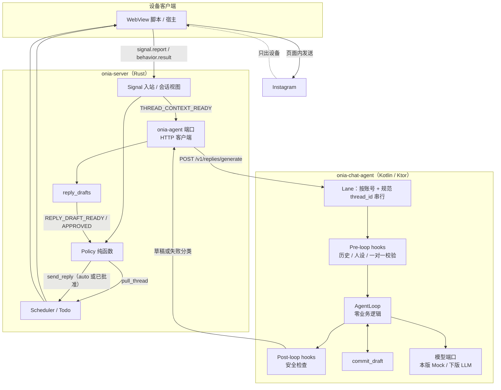
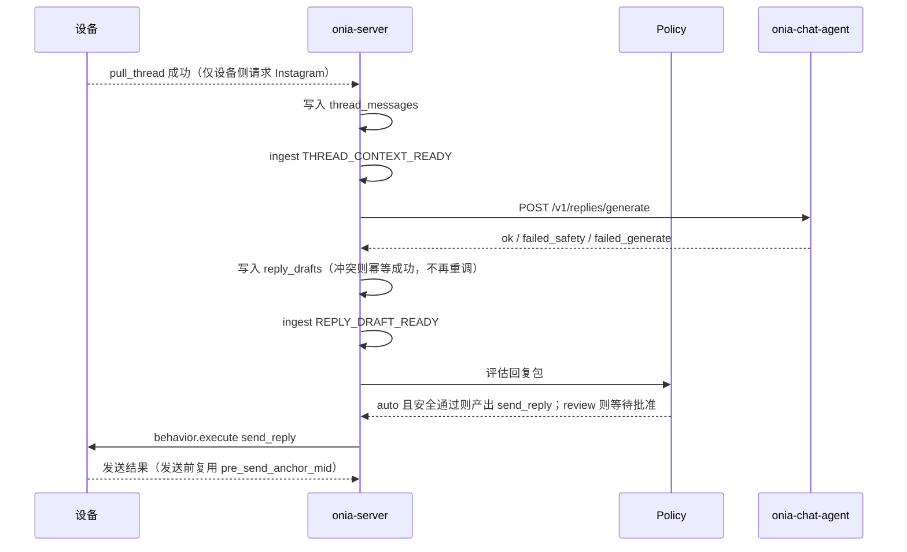

# Onia Instagram 回复聊天 Agent（Kotlin）技术方案

本文给出 Onia「收到 Instagram 私信后生成回复」的聊天 Agent 方案：Agent 本身用 Kotlin 实现，并配套后台与接入。管线仍以已有的阶段 C 方案 [instagram-auto-reply.md](instagram-auto-reply.md) 为准，不另起发送管线，不改 Onia / sitin-next 仓库代码。

对照参考：[presence-io/aichat-v2](https://github.com/presence-io/aichat-v2)（私有仓，Kotlin 2.1 / JVM 21 / Ktor，核心赌注是 `Agent = LLM + Loop + Tools`）。本文只借鉴其可独立成立的架构原则和「只生成、不投递」的接入形态，**不把该仓库的源码、内部接口、提示词或公司服务迁入 Onia**。

## 结论

1. **聊天 Agent 做成 monorepo 里的独立 Kotlin 服务 `onia-chat-agent`，不要在 Rust 服务端里再堆一套生成逻辑，也不要把 aichat-v2 整仓引入 Onia。** 现有 `onia-agent` crate 保留为端口：对内实现 `ChatAgent`，对外只做 HTTP 客户端。Policy、草稿表、`send_reply` 仍然在 `onia-server`。
2. **Agent 只生成草稿，永远不发 Instagram。** 这与 aichat-v2 后期「SyncReply / generateOnly：生成器不投递」以及它给 Social Proxy 预留的 `POST /api/social-proxy/ig-reply`（同步返回文案）是同一类边界。Onia 的发送仍由 Policy 在 `REPLY_DRAFT_READY` / `REPLY_DRAFT_APPROVED` 之后产出 `send_reply`，由设备客户端发出。硬约束不变：Instagram / CDN 请求只出设备。
3. **运行时采用精简后的 Agent Loop，而不是工作流写死「拉完再回复」。** 循环只做：调模型、处理 tool call、产出草稿。业务决策放在 Hook、Tool 或模型里。本版本注册的终点工具叫 `commit_draft`（提交一条待审/待发草稿），不要叫 `send_message`，以免和 Onia 已有的运营动作混淆。
4. **本版本先接通契约和 Mock，真实模型只换适配器。** Mock 仍从 `['hi','how are u','u?','im good']` 随机取一条，实现写在 Kotlin 服务里，不得写进 `send_reply` 脚本或 Behavior。账号默认模式仍是 `review`，测试账号可用 `auto`。失败分类与阶段 C 一致：无正文的 `failed_safety` / `failed_generate` 不能变成可批准草稿；有正文、需要人确认时才降为待审。
5. **后台继续以 PostgreSQL 为业务主库。** 会话视图、`reply_drafts`、账号回复设置、会话接管都留在 Onia 服务端。Kotlin 服务默认无状态，不持社媒 cookie / session，不自己去平台拉历史。本版本不必引入 Nacos、公司 Kafka / TIM / 风控 gRPC 或向量检索。
6. **接入点只有一处：`THREAD_CONTEXT_READY` 之后，由 `onia-server` 同步调用 Agent 的生成接口。** 以规范 `thread_fbid` 和已落库的 `thread_messages` 为输入，以 `inbound_message_id` 做幂等；唯一约束冲突按幂等成功处理，不重复调用 Agent。

## 对照 aichat-v2：借鉴什么，不迁什么

aichat-v2 是面向数字人 1 对 1 对话的聊天后端，组装方式是：

```
Trigger → Pre-loop hooks → AgentLoop（纯 LLM + function calling）→ Post-loop hooks → Delivery
```

对 Onia 有直接参考价值的，是下面几条已经验证过的原则，而不是它的产品功能清单。

### 值得借鉴

- **核心赌注：** `Agent = LLM + Loop + Tools`，`AgentRuntime = AgentLoop + Hooks`。AgentLoop 内不写业务 if-else，扩展靠注册 Hook / Tool / 模型客户端。
- **上下文预注入：** 历史、人设等基础上下文由 Pre-loop Hook 确定性写入，不让模型先花一轮去「读历史」。多数回复一轮即可 `commit_draft`。
- **同一会话串行：** 按会话加锁，同一 `thread_id` 上不要并发跑两轮生成，避免草稿交叉。
- **生成与投递分离：** 新消息到来时，未发出的旧回复应被取消。在 Onia 里，这一点落在两层：Agent 侧取消或作废进行中的生成；设备发送前用已有的 `pre_send_anchor_mid` 检查，若对方已有新消息，则把旧草稿标 `discarded` 并取消未完成的 `send_reply`。
- **安全分层、失败即关闭：** 模型输出、提交草稿、服务端落库前各自再检查一遍，不假设上游已经清理。无可用正文就失败，不要放行空白或错误文案。
- **人设与提示词外置：** Persona 用 YAML（或等价配置）版本管理，换人设不改循环代码。
- **只生成的同步接口：** 调用方提供会话上下文，服务返回文案或失败原因，由调用方决定审、发、弃。这比把 aichat-v2 的 TIM 投递搬过来更适合 Onia。

### 明确不迁入 Onia

- 不把 aichat-v2 作为 git submodule，不复制其源码、提示词、Persona 正文、内部 Redis 键或公司身份字段。
- 不接入 TIM、公司 Kafka 主题、Nacos、BytePlus、chemistry / contact-exchange、天枢编排控制面，以及舔狗 / 追发 / 挽回 / 线下见面 / 视频引导等数字人产品能力。
- 不把 sitin-next 里脚本自己调用 `getChatMessages` 的做法迁入；发送前检查复用 Onia 已有的 `pre_send_anchor_mid`。
- Agent 不得成为 Instagram 请求的出口，也不得持有设备会话去代发。

若日后要复用 aichat-v2 里已经很稳定的某一段纯算法（例如输出清洗、气泡切分），只能在独立实现中按公开思路重写，并保持 Onia 自己的包名、契约和配置。

## 总体架构



### 各端职责

| 部分 | 做什么 | 不做什么 |
|------|--------|----------|
| 设备客户端 | 监听、拉会话、发送、发送前锚点检查；上报能力 `inbox.send_reply.v1` | 不内置模型，不写死「拉完再回复」 |
| `onia-server` | 事实与视图、Policy、Todo / Behavior 调度、草稿生命周期、账号模式与会话接管 | 不调 Instagram，不在 `apply_behavior_result` 里直接插发送 Todo |
| `onia-agent` crate | `ChatAgent` 接口 + 调用 Kotlin 服务；测试可保留进程内 Mock 作为断路回退 | 不实现真实提示词和模型路由 |
| `onia-chat-agent` | 根据已落库上下文生成草稿；安全分类；按会话串行；写出 trace | 不投递、不持会话、不自己拉 Instagram 历史 |
| Policy | 按 `review` / `auto` / `suggest` 决定是否产出 `send_reply` | 不调用模型 |

打招呼回归仍走既有的手动「关注 + 打招呼」，不进回复包，也不进这个 Agent。

## Kotlin Agent 技术方案

### 模块与技术栈

建议放在 Onia monorepo 的 `apps/chat-agent/`（名称可调整，但必须是独立 Gradle 工程，不和 Rust 混编）。

| 层 | 选择 |
|---|---|
| 语言 | Kotlin 2.1，JVM 21，协程 |
| HTTP | Ktor 3，kotlinx.serialization |
| 测试 | Kotest（或 JUnit 5），loop / hook / 契约测试为主 |
| 配置 | 环境变量 + 本地配置文件；本版本不用 Nacos |
| 数据 | 默认无状态；可选把 trace 写文件或写回 Onia PostgreSQL。不要为本版本新建一套业务库 |

包分层与 aichat-v2 同向，但只保留 Onia 需要的包，依赖只能向下：

| 层 | 包 | 职责 |
|---|---|---|
| 边界 | `routes/` | 健康检查、生成接口、按 id 查 trace |
| 编排 | `runtime/` | `AgentLoop`、`AgentRuntime`、按会话 `LaneManager` |
| 编排 | `hooks/`、`tools/` | Pre/Post hook；`commit_draft` |
| 业务 | `safety/`、`persona/` | 输出安全；人设加载 |
| 能力 | `llm/`、`trace/` | 模型端口（Mock / 真实实现可替换）；trace |
| 基础 | `models/`、`config/` | 请求 / 结果 / Trigger 等纯数据；配置 |

`Application.kt` 是唯一组装根。新增能力只注册 Hook / Tool / `LlmPort`，不改 Loop。

### 运行时法则

1. **AgentLoop 内不写业务逻辑。** 循环只接触发、调模型、执行已曝光的 tool、收集结果。
2. **基础上下文由 Hook 注入。** 请求里已经带来的 `messages`、人设、账号模式，在进入循环前写成模型可读的 system / 对话数组。历史必须是轮次消息，而不是整段塞进 system。
3. **本版本终点工具只有 `commit_draft`。** 成功即结束循环，产出一条正文。不要注册任何会访问 Instagram、对象存储或设备桥的 tool。
4. **模型可以一次提出多个 tool call，但运行时必须逐个执行，并在每个边界重新校验。** 若此时该会话又有更新的入站、或 `commit_draft` 已经成功，剩余调用不再执行。不要只取第一个就丢掉其余，也不要盲目批量执行。
5. **同一 `platform + account_id + thread_id` 同时只跑一轮生成。** 新一轮到来时，取消上一轮尚未提交的生成，避免两份草稿打架。取消后的结果不得当作成功草稿写入。
6. **失败即关闭。** 安全或解析失败且没有可用正文时，返回 `failed_safety` / `failed_generate`，不要返回空字符串充数，也不要把这种失败写成可批准草稿。

本版本不启用多候选竞技、不启用联网搜索、不启用 RAG。这些都不是回复闭环的前提。

### 建议的核心接口（示意，不是现码）

```kotlin
fun interface LlmPort {
    suspend fun complete(request: LlmRequest): LlmResponse
}

fun interface ChatAgent {
    suspend fun generate(request: GenerateReplyRequest): GenerateReplyResult
}

sealed class GenerateReplyResult {
    data class Ok(
        val text: String,
        val safetyOk: Boolean,
        val model: String,
        val traceId: String,
    ) : GenerateReplyResult()

    data class FailedSafety(val reason: String, val traceId: String) : GenerateReplyResult()
    data class FailedGenerate(val reason: String, val traceId: String) : GenerateReplyResult()
}
```

`LlmPort` 本版本提供 `MockLlmPort`：忽略提示词，从上述 4 个固定字符串中均匀随机取一条，并标记 `safety_ok=true`、`model=mock_v1`。下个版本只替换为真实 `LlmPort`（单主模型 + 可配置回退即可），Loop 和 HTTP 契约不变。密钥只留在 Agent 服务端环境里。

### 本版本 Hook 清单

只做最小闭环，避免把数字人那一套二十多个 Pre-hook 搬过来。

**Pre-loop**

- `OneToOneGateHook`：不是一对一或无法判定则直接失败，不进循环。判定结果以请求里已写好的会话元数据为准（来自 `pull_thread`，不是收件箱标题猜测）。
- `PersonaHook`：加载该账号 / 人设 YAML，写入 system。
- `HistoryContextHook`：把请求中的消息做成对话轮次；过滤自己发出的消息方向，避免模型把己方旧回复当成对方来消息。
- `InboundAnchorHook`：确认目标 `inbound_message_id` 仍是当前待回的对方消息；对不上则 `failed_generate`，不编造新的 message_id。

**Post-loop**

- `OutputSafetyHook`：规则清洗（空白、过长、明显自相矛盾的元标记）。本版本不做复杂分类器；真实模型上线后再加一层模型侧分类。无正文可用时走 `failed_safety`。
- 暂不做人设口吻格式化。需要时再加，并且必须钉在安全检查之后、返回之前。

## 配套后台方案

后台指 Onia 服务端与数据面，不在 Kotlin 服务里再做一套业务真值。

### 仍由 `onia-server` 持有的真值

- `thread_messages` 会话视图，以及阶段 B 的 `thread_cursors`（规范键是 `thread_fbid`）。
- `reply_drafts`：一则入站对应一份有效草稿；状态包括待审、已批准、已拒绝、已发送、`discarded`、`failed_safety`、`failed_generate`。
- `account_reply_settings`：账号级 `review` / `auto` / `suggest`。未配置则默认 `review`。
- 会话接管与一对一判定：写在同一份会话元数据上（扩展 `thread_cursors`、薄 `threads` 表或独立 `thread_takeovers`），不要和账号级开关混成一个字段。
- Signal / Todo / Behavior、Policy 纯函数、Scheduler。同一设备上 `send_reply` / `send_message` / `send_greet` 同时只晋升一条；`send_reply` 只由 Policy 产出，不得加入 `MANUAL_ACTIONS`。

这些表的字段扩展、弱路径归一、按会话去重，以 [instagram-auto-reply.md](instagram-auto-reply.md) 已锁定的修订为准，本文不重复展开，也不改那三处结论。

### Kotlin 服务在后台中的位置

- 作为内部服务与 `onia-server` 一同部署（本机或同一份 docker compose 即可）。只监听内网或本机端口，不对外暴露生成接口。
- 调用鉴权用服务间共享密钥（环境变量），不要用 Instagram cookie，也不要把该接口做成公网开放 API。
- 配置：监听地址、共享密钥、默认 persona、模型端口类型（`mock_v1` / 日后的真实模型）、单次生成超时、单会话并发（固定为 1）、最大历史条数。超时做成可配置项，不在本文写成固定 SLA。
- 观测：每次生成一个 `trace_id`，至少记录入站 id、所用 persona、模型名、是否取消、失败分类。本版本可以把 trace 先落本地日志；需要排障界面时再入库。
- 扩容不是本版本目标。需要水平扩展时，Lane 锁再改为共享锁；在此之前单实例足够。

### 与现有 `onia-agent` crate 的关系

现码 `onia-agent` 仍是 P0 桩，且 `onia-server` 已经依赖它。推荐这样接通，而不是再开平行 crate：

1. 在 crate 里把 `ChatAgent` 收成稳定接口，返回值与上文 `GenerateReplyResult` 对齐。
2. 默认实现改为 HTTP 客户端，指向 `onia-chat-agent`。
3. 仅在集成测试或 Agent 服务不可用的显式开关下，才使用进程内 Mock。生产闭环以 Kotlin 服务为准，避免两处 Mock 行为分叉。
4. 草稿唯一约束冲突的「视为成功、不再调用 Agent」，放在 `onia-server` 落库处，不放在 Kotlin 循环里靠重试硬碰。

## 接入方案

### 调用时机

只在以下条件同时满足时调用 Agent：

- `pull_thread` 成功，消息已写入 `thread_messages`，并已 ingest `THREAD_CONTEXT_READY`；
- 会话是一对一，且未被接管；
- 目标入站消息尚未有有效草稿（含待审、已批准、已发送），也没有进行中的 `send_reply`；
- 不需要等全文历史回补完成，只要最新一页里已有这条未处理的对方消息。

弱事件路径必须先把收件箱会话键归一成 `thread_fbid`，解析不到或 `thread-unknown-*` 的会话不得调用 Agent。

### HTTP 契约

建议：`POST /v1/replies/generate`（同步）。字段用 Onia 自己的命名，不要沿用公司侧的 `creatorId` / `chat:{min}:{max}` / `womanSocialId` 等身份。

请求（示意）：

```json
{
  "request_id": "uuid",
  "trace_id": "可选，服务端传入则沿用",
  "platform": "instagram",
  "account_id": "平台账号主键",
  "thread_id": "规范 thread_fbid",
  "inbound_message_id": "对方这条消息的平台 id",
  "is_one_to_one": true,
  "mode": "review",
  "persona_id": "default",
  "messages": [
    {
      "message_id": "…",
      "direction": "in",
      "sender": "peer",
      "text": "…",
      "sent_at": "2026-11-13T10:00:00+08:00"
    }
  ]
}
```

`mode` 只用于提示词或日志，**不授权 Agent 发送**。是否产出 `send_reply` 仍由 Policy 决定。`generate_only` 在协议上恒为真，不必让调用方关闭它。

成功响应（示意）：

```json
{
  "status": "ok",
  "text": "how are u",
  "safety_ok": true,
  "model": "mock_v1",
  "trace_id": "…"
}
```

失败响应用同一信封：`status` 为 `failed_safety` 或 `failed_generate`，`text` 为空，附 `reason` 与 `trace_id`。不要用 HTTP 200 返回空正文假装成功。参数不合法用 4xx；服务自身故障用 5xx，由 `onia-server` 记为 `failed_generate`，不降级成可批准草稿。

另提供 `GET /health` 与 `GET /v1/traces/{trace_id}`（本版本可先只返回本地日志摘要）。

### 时序



`review` 在草稿待审处停下，后台最小可用的确认 / 改写 / 拒绝即可。`suggest` 只留草稿。发送前若发现对方新消息：旧草稿标 `discarded`，取消其未完成的 `send_reply`，再按新的入站重新走「视图更新 → Agent → Policy」。

### 超时、取消与重试

- 超时由 `onia-server` 与 Agent 两侧同时配置，以服务端调用超时为准。超时记 `failed_generate`，可按同一 `inbound_message_id` 有限次重试；一旦已有成功草稿，禁止再调。
- 同一会话新的 `THREAD_CONTEXT_READY` 到来时，服务端应取消仍在途的旧请求（若运行时支持），或丢弃后到的旧响应。
- 不得用重试去覆盖「唯一约束已命中」的情况：那是幂等成功。

### 客户端与测试接入

测试步骤仍以阶段 C 为准，本文只补 Agent 服务这一环：

1. 确认客户端已上报 `inbox.send_reply.v1`。
2. 确认该会话没有未读、没有未完成的 `pull_thread` / `send_reply`、没有未处理草稿。
3. 确认 `onia-chat-agent` 健康，且该次测试走 `mock_v1`。
4. 再把测试账号 `24264435413` / `hwangdohyeon165` 设为 `auto`，由对端 `colna.null` 发一条新私信。
5. 期望：设备拉会话 → 服务端调用 Agent → 落草稿 → Policy 产出 `send_reply` → 设备发出 Mock 文案之一。

测试设备仍是 `4f311d52-6f63-4a5d-b26e-cc84f497f104`（Onia 手机，用户 `111@163.com`），不要用旧设备或 `local-sim`。

## 分批落地

阶段 C 的管线方案仍须等 Code Reviewer 复核那三处必须改通过后，再交 Coder 实现。本文是 Agent 与接入的配套方案，不提前开工，也不绕过那次复核。

| 批次 | 内容 | 说明 |
|------|------|------|
| C0 | 阶段 C 管线（拉会话、视图、Policy、`send_reply`、去重与弱路径归一） | 以 `instagram-auto-reply.md` 为准 |
| C1 | 本仓库新增 `apps/chat-agent`，接通 `POST /v1/replies/generate` 与 `MockLlmPort`，`onia-agent` 改为 HTTP 客户端 | 先跑通契约，不接真实模型 |
| C2 | 替换为真实 `LlmPort`，补 Persona YAML、输出安全与 trace 查询 | 不改 HTTP 契约，不改 Policy |
| 以后可选 | 共享 Lane 锁、更完整的安全分类、管理台看 trace | 按需，不作为闭环前提 |

回滚：把账号模式改回 `review` 或关闭自动回复即可停止自动发送；把 `onia-agent` 指回进程内 Mock 或关掉生成调用，不影响拉会话与手动打招呼。

## 假设说明

1. 用户要求「语言也用 Kotlin」，本文将其理解为：**生成回复的 Agent 运行时用 Kotlin 独立服务**，而不是把 Onia 服务端从 Rust 改写成 Kotlin，也不是在 Android 客户端里做生成。
2. aichat-v2 为私有仓，本文依据其 `main` 上的 README、架构文档、agentkit 设计，以及 Social Proxy / SyncReply 相关设计阅读；不以复制其接口字段为兼容目标。若该仓后续改动，只需核对「只生成、不投递」这一边界是否仍然成立。
3. 不把 aichat-v2 的 Social Proxy 超时、候选条数或其他运行参数当作 Onia 的容量或时延指标。Onia 的超时与重试次数在实现时用配置给出，不在方案里编造。
4. 本版本真实模型的供应商尚未指定；C2 再定，且必须可替换。
5. GitLab MR 1462 远程 refs 此前未能取到，脚本对照继续以本机只读的 `feature/sp-ig-dm-api` 与当前工作树为准，不 checkout / stash / commit。
6. 若希望把本文收入 colna-memo 作为与 `instagram-auto-reply.md` 配套的长期文档，路径建议为 `memory/10-Projects/onia/instagram-chat-agent-kotlin.md`。
