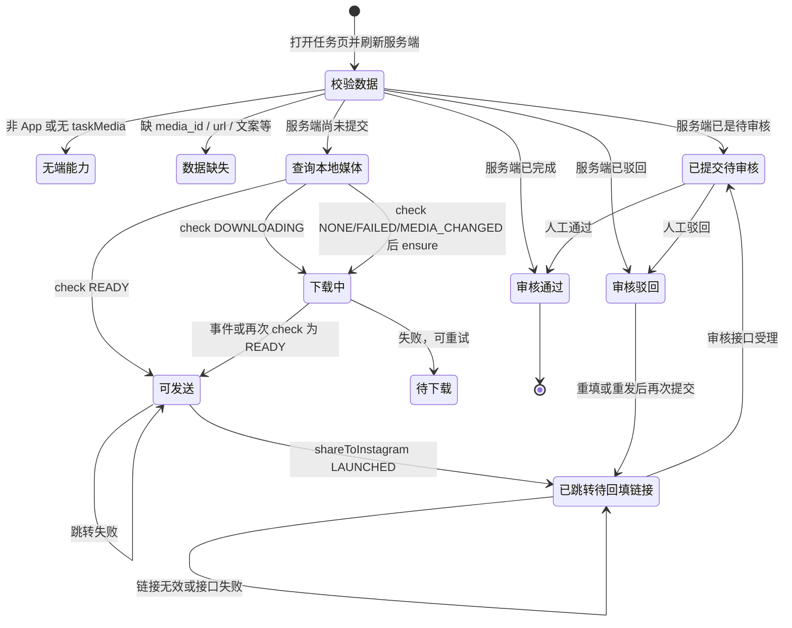

# PWA Partner「发布 Instagram 商品帖」技术方案 / 实现方案

- 产品线：Sitin PWA 的 Partner 任务（首页「Become a partner」区块），不与 Onia 自动发帖、也不与 Verlume 混写。
- 成稿日期：2026-11-24（Asia/Shanghai）。
- 状态：技术 / 实现方案评审稿。本文只出方案，不开发、不改业务仓库、不写入飞书。
- 用途：替换目标飞书页中现有的「界面与交互设计说明」段，作为研发可落地的实现方案；memo 仍为真源。
- 目标飞书页（本文不直接写入）：[Partner 相关 wiki](https://presence.feishu.cn/wiki/VWvHwUrBRii5AIk7V0QcUNDEnmf)
- 产品说明（需求真源）：[pwa-partner-instagram-product-post](pwa-partner-instagram-product-post.md)
- 端能力文档（客户端契约真源，已读）：[端能力 wiki](https://presence.feishu.cn/wiki/TMYWwzswqiEr9mkHWcacwJRTnPf)（文档 ID `C2AUdJQpuoNi56xRX4TcecDanAh`，读取时 revision 140）
- 界面对照：设计说明第 4.2 节与预览 HTML（How to post 为可左右滑动的图文步骤条）。图中 `+$2.00` 只是版式占位，不是真实分成或定价。

本文默认简体中文。界面可见文案仍按产品说明与设计，默认英文。不编造 QPS、延迟、容量、审核时效或奖励数字。

---

## 1. 文档定位

本文回答「PWA、客户端端能力、服务端审核如何接起来」，不重复界面视觉规范。状态、字段、完成口径以产品说明为准；**方法名、入参、回调与媒体生命周期以端能力文档为准**。产品说明第 7 节曾建议 `downloadVideoToAlbum` / `openInstagramProductPostEditor`，与端能力现文不一致，**实现时不得沿用这两个建议名，也不得再发明与现文冲突的新能力名**。

目标飞书页当前包含两段：产品说明，以及「界面与交互设计说明」。本文件对应替换后一段。

---

## 2. 硬约束

1. **禁止**用现有 `finishUserCommonTask` 提交帖子链接或完成本任务。现网请求体只有 `task_id`（见 `FinishUserCommonTaskRequest`），不能携带 URL，且成功即完成任务，会跳过人工审核并可能误发奖。
2. **禁止**复用 taskid **2005**。2005 已占用为前端本地授权任务 `PartnerAuthorization`（后端不下发，仍勿复用）。2000–2004 亦不得侵占。本任务建议新 id **2006**，枚举名建议 `PartnerIgProductPost`（假设，见第 13 节）。
3. 点击「完成」只表示提交审核；**人工审核通过后，由服务端将任务置为完成并发奖**。不得在下载成功、跳转 Instagram 或点击「完成」时当作已完成。
4. 不通过 Social Proxy / Onia 自动代发，不绕过用户在 Instagram 内的手动操作。
5. 跳转发帖时，PWA 必须在自身逻辑中保留并使用当前任务 `extra` 的**全部键值**（展示、复制、以及若端能力后续扩展接收 extra 时原样下发）。不得只解析部分键后把其余键丢掉。与现网 `shareToInstagram` 入参的差异见第 6 节，不得为此改用 `openDeepLink` 打开一个不含任务上下文的固定链接来代替。
6. 现有 `TaskStatus` 只有 `notStart` / `finish`。待审核不得写成 `finish`，以免重现 2000 任务「PENDING 被当成已完成而隐藏卡片」的问题。
7. 文档、代码、日志、接口说明中不出现出图服务、密钥、签名或内部凭证。
8. 不把站外购买 / 站外下单写成步骤或审核项。

---

## 3. 系统边界与模块划分

建议在现有 monorepo `sitin-next` 的 `packages/app-pwa` 内实现，不新建独立仓库，不改 Onia。

| 模块 | 职责 | 不负责 |
|---|---|---|
| 服务端 common task | 下发本类任务（建议 taskid 2006）；在任务数据中提供媒体版本与展示字段；提供「提交审核」新接口；人工审核通过后置完成并发奖 | 不持 Instagram cookie，不代发，不写系统相册 |
| PWA（`packages/app-pwa`） | Partner 入口卡、独立任务页、步骤条与复制区、能力探测、下载/跳转编排、链接浅校验、提交审核、本地阶段持久化、回前台刷新 | 不自己把远程视频写入系统相册，不轮询审核，不调用 `finishUserCommonTask` |
| 客户端 Native | 唯一端能力 `taskMedia`（action：`ensure` / `check` / `shareToInstagram` / `submit`）及事件 `onTaskMediaEvent` | 不判断任务是否业务完成；不接收审核链接 |
| Instagram | 用户手动发 Reel、标签商品、粘贴文案 | 非我方系统 |

建议前端落点（名称可调整，职责不要拆乱）：

- 类型与集合：`TaskId.PartnerIgProductPost`；将该 id 加入 Partner 区块集合（现网 `PARTNER_TASK_IDS` 目前只含 2000–2004），但**完成态隐藏逻辑必须识别审核中 / 驳回，不得把待审核当 finish**。
- 页面：独立路由任务详情页（设计建议 `/partner/ig-product-post`，待纳入现有路由规范）。
- Hook / Store：例如 `usePartnerIgProductPost` + 本地持久化 store（按任务实例 + `mediaId` 分键）。
- Bridge 封装：在现有 `utils/bridge.ts` 之上增加 `taskMedia` 的 typed wrapper（`ensure` / `check` / `shareToInstagram` / `submit`），事件用现有 `registerBridgeHandler('onTaskMediaEvent', …)` 注册。
- HTTP：新增「提交审核」封装，**不要**改 `finishUserCommonTask(taskId)` 的语义来夹带 URL。

---

## 4. 与现网及端能力文档的对齐

查阅时间：2026-11-24。本机 `COLNAdeMacBook Pro`（machineId `7fe3642f-50a5-407b-b6d5-31dfdc4c1098`）。PWA 与 proto 只读核对，未改仓库。

已对齐的现网事实：

- Partner 入口在 Task 页「Become a partner」区块：`PartnerAdsSection`、`usePartnerTasks`、`partnerTasksStore`。
- 任务列表走 `listAllCommonTasks`。`CommonTaskInfo` 现有字段为 `task_id`、`title`、`reward`、`extra`（`map<string, string>`）等；列表级带 `biz_date`。`ITask.extra` 为 `Record<string, string>`。
- `finishUserCommonTask` 请求体只有 `task_id`。2001–2003 达成后 Claim、2004 回前台校验通过后，才走该接口。本任务不能套用该模型。
- `TaskStatus` 仅 `notStart` / `finish`。`UserCommonTaskInfo.status` 虽为字符串，现网曾把非完成状态误标为已完成。
- Bridge：`isApp()` 探测 `window.pwaBridge`；`hasNativeMethod(name)` 按 `pwaBridge` 上同名函数探测，不靠试调用；`invokeBridge(method, params)` 的回包为 `{ code, reason, payload }`；`registerBridgeHandler` 会先 `JSON.parse` 再交给业务（与端能力文档示例里手动 `JSON.parse(rawEvent)` 略有差异，封装时不要重复 parse 到报错）。
- 现成跳转能力 `openDeepLink` 只接受 `deep_link` + `fallback_url`，2000 / 2004 使用它打开固定 deeplink，**不能**代替本任务的 `taskMedia.shareToInstagram`。
- 复制可复用现有 `copyToClipboard`（2004 已用于 `promote_url`）。

端能力现文要点（实现必须遵守）：

- Web 侧只有 **一个** 方法：`taskMedia(params, callbackId)`。`params` 为 JSON 字符串，公共字段 `action`、`taskId`、`mediaId`；`callbackId` 由 Bridge 生成，Web 不传。现网 `invokeBridge('taskMedia', jsonString)` 即可对接。
- 四个 action：`ensure`（需要时下载）、`check`（只查不下载）、`shareToInstagram`（用本地已 READY 的媒体打开 Instagram，**不接受 URL**）、`submit`（任务提交后立即清理本地媒体）。
- 下载终态事件：`onTaskMediaEvent`，且**只有 ensure 返回 DOWNLOADING 后**才会触发；缓存命中直接 READY 不发事件。
- 服务端最小字段：`task_id`、`media_id`、`media_url`。缺 `task_id` 或 `media_id` 时，客户端无法建立任务媒体版本关系。
- 本地媒体是**私有存储**：**不写入系统相册**，不使用 cacheDir；`submit` 或 TTL 到期后清理；退出登录也会清理。`shareToInstagram` 成功只表示 Instagram 被拉起（`status: LAUNCHED`），视频时 `target` 为 `reels`，不代表已发布。

---

## 5. PWA 与端能力对接

### 5.1 能力探测

进入任务页或点亮下载/发送之前：

1. `isApp()` 为假（纯浏览器、无 `pwaBridge`）：判定无端能力。
2. `waitForBridge()` 之后，`hasNativeMethod('taskMedia')` 为假：判定宿主未实现本能力（旧版 App）。
3. 以上任一失败：整页或发送区提示需在 App 内完成，**不自动下载、不点亮 Post**。默认不做 H5 降级下载，也不改为「只复制视频链接让用户自己保存」却不说明限制（是否另附手动指引待确认，见第 13 节）。

不要用试调用 `ensure` 来探测，避免副作用。

### 5.2 调用约定

建议封装为单一入口，例如 `callTaskMedia(action, payload)`，内部 `invokeBridge('taskMedia', JSON.stringify({ action, ...payload }))`，按端能力文档解析 `code` / `payload.status` / `payload.error`。

**页面初始化顺序（硬性）：**

1. 注册 `onTaskMediaEvent`（建议只注册一次；可在 `initBridge` 或任务页挂载时通过 `registerBridgeHandler` 注册）。处理器必须过滤 `event === 'downloadFinished'`，以及当前 `taskId`、`mediaId`。
2. 先 `check({ taskId, mediaId })`，再决定是否 `ensure`。
3. `check` 为 `READY`：直接进入可发送。
4. `check` 为 `DOWNLOADING`：展示「视频下载中」，等待事件；事件可能丢失，回前台或刷新后再 `check`。
5. `check` 为 `NONE` / `MEDIA_CHANGED` / `FAILED`：调用 `ensure({ taskId, mediaId, url })`。`url` 取服务端媒体地址（见第 6 节），不得改用其它字段拼出来的地址。
6. `ensure` 回包只有 `READY` 或 `DOWNLOADING`（`code === 0`）。同步失败（`code === -1`，如 `INVALID_ARGUMENT`、`UNSUPPORTED_SCHEME`、`STORAGE_UNAVAILABLE`、`TASK_BUSY`）按下载失败展示，允许重试。下载过程中的网络或落盘失败**不会**出现在 ensure 回包，只通过事件 `FAILED` 到达。
7. 仅当本地媒体 `READY` 后，才允许调用 `shareToInstagram({ taskId, mediaId })`。该 action **不传 URL**，Native 会再次校验 READY。
8. 仅当服务端「提交审核」已被受理后，才调用 Native `submit({ taskId, mediaId })` 清理本地媒体。不要在跳转成功时调用，也不要在链接校验失败或审核接口失败时调用。端能力原文：「需要等用户回填写 ins url 提交再调用」；`submit` 会**立即删除**本地媒体。

`taskId`、`mediaId` 在端能力中为 1–128 字符的字符串。现网 `CommonTaskInfo.task_id` 是 `int32`，调用 Native 时需转为字符串。若服务端另给实例级 ID，优先用实例级 ID，见第 6.2 节。

可选 `ttlMs` 默认 24 小时、最大 7 天。本方案默认不改 TTL：用户应在下载成功后完成跳转与提交；若停留过久媒体过期，恢复时 `check` 非 READY，则重新 `ensure`，发送按钮在再次成功前保持熄灭。

### 5.3 失败回退

| 场景 | 端能力表现 | PWA 处理 |
|---|---|---|
| 无 Bridge / 无 `taskMedia` | 探测失败 | 提示在 App 内完成；不下载、不发送 |
| `ensure` 同步错误或事件 `FAILED` | `DOWNLOAD_FAILED`、`TIMEOUT`、`STORAGE_UNAVAILABLE`、`SAVE_FAILED`、`DOWNLOAD_INTERRUPTED` 等 | 展示 `error.message`（权限/存储类需说明需要存储空间或相应权限）；发送禁用；提供 Retry download；不可假装已成功 |
| 下载中 WebView 被回收或进程被杀 | 事件可能丢失；重启后 `check` 可能为 `FAILED` + `DOWNLOAD_INTERRUPTED` | 恢复时必须先 `check`，不能用本地「曾经下载过」点亮发送；需要则重新 `ensure` |
| `mediaId` 变化 | `check` 为 `MEDIA_CHANGED`；旧下载可能收到 `CANCELED` | 用新 `mediaId` 重新 `ensure`；旧 id 不得再用于 `shareToInstagram` 或 Native `submit` |
| `shareToInstagram` 失败 | `INSTAGRAM_NOT_INSTALLED`、`INSTAGRAM_HANDLER_UNAVAILABLE`、`MEDIA_NOT_READY`、`ACTIVITY_UNAVAILABLE`、`SHARE_FAILED` 等 | 留在可发送，展示原因，允许重试 Post；**不进入**待回填；不强制重新下载（若仍为 READY） |
| Native `submit` 返回 `STALE_SUBMIT` | 请求 mediaId 已过期，未删除当前新媒体 | 忽略旧请求；若审核已受理且确需清理，用当前 `mediaId` 再提交一次 Native `submit` |
| Native `submit` 返回 `CLEANUP_FAILED` | 本地记录可能仍在 | 服务端审核单已成立则不回滚；可稍后重试清理或等 TTL。不要因此把审核态改回待回填 |

错误码完整表以端能力文档「错误码」节为准，本文不重复抄全。PWA 展示优先用回包 `error.message`，再按 code 给兜底文案。

---

## 6. 字段映射与 extra 透传

### 6.1 服务端必须提供的数据

端能力要求至少：

| 字段 | 必填 | 用途 |
|---|---|---|
| `task_id` | 是 | 任务类型或实例 ID；Native `taskId` 的来源之一 |
| `media_id` | 是 | 媒体版本。内容变化时必须变；相同 `media_id` Native 不会重复下载 |
| `media_url` | 是 | HTTPS（或 HTTP）媒体下载地址，最大 4096 字符 |

产品说明还要求展示 / 复制：

| 键（假设，建议 snake_case，与 2004 的 `promote_url` 对齐） | 用途 |
|---|---|
| `caption` | 发帖文案，展示 + 复制 |
| `product_name` | 商品名称，展示 + 复制 |
| `shop_name` | 店铺名称，展示 + 复制 |

现网 `CommonTaskInfo` **没有**一等字段 `media_id` / `media_url`，只有 `extra` 字符串 map。本方案默认：`media_id`、`media_url`、`caption`、`product_name`、`shop_name` 均放在 `extra` 中下发。若后端已用产品说明中的 `video_url` 作为下载地址，PWA 将其视为 `media_url` 的别名解析，**不在客户端改名后再存一份**。若两键同时存在且不一致，视为任务数据不完整，不开始下载（待后端确认优先级前不要擅自选边）。

四个展示/下载相关字符串均不能为空；再加 `media_id` 不能为空。任一缺失：任务页展示「任务信息不完整」，不自动 `ensure`，不点亮发送，不用录屏示例值填空。

`media_url` 必须是可直接下载的媒体地址。返回 HTML 登录页、错误页或需要额外 Cookie 的地址会导致 `NOT_MEDIA` 或 `DOWNLOAD_FAILED`。视频单文件上限端能力写明为 500 MB（超过为 `FILE_TOO_LARGE`）；本文不另编容量指标。本任务只接受视频：`ensure` / `check` 后若 `mediaType` 为 `image`，按任务数据错误处理，不得走 `target: feed` 的图片分享。

奖励金额只展示 `listAllCommonTasks` 返回的 `reward`；无则不展示。设计稿中的 `+$2.00` 仅为版式占位。

### 6.2 Native `taskId` 与类型 id 2006

端能力规定：`task_id` 在任务生命周期内保持不变；**不要用同一个 task_id 表示另一个新任务**。现网 common task 的 `task_id` 是类型 id（如 2004），同一用户后续下发的「新一次任务」可能仍是同一个数字。

本方案默认（待确认）：

- 列表过滤、前端枚举仍用类型 id（建议 2006）。
- 调用 `taskMedia` 时，若 `extra`（或其它已确认字段）提供了实例级稳定 ID（建议键名 `assignment_id`），则 Native `taskId` 用它；否则在「同一用户同一时间只有一条未完成本类任务」成立的前提下，可用 `"{task_id}:{biz_date}"` 合成，避免跨日任务共用同一本地媒体槽。若后端确认类型 id 本身即可作为 Native `taskId`，再简化为字符串化的 `2006`。
- **禁止**用 `media_id` 充当 `taskId`（媒体版本会变，任务身份不应变）。

### 6.3 extra 透传规则

产品硬约定：调用「跳转发帖」时把当前任务 `extra` 的全部键值交给客户端能力，以便服务端以后新增字段时不必先改 PWA 白名单。

端能力现文中，`shareToInstagram` 的入参**只有** `action`、`taskId`、`mediaId`，明确不接受 URL，也**没有** extra 字段。这是与产品约定的真实缺口，而不是实现时可以忽略的细节。

本方案默认落地方式（不静默取消产品约定）：

1. PWA 全程保留 `extra` 原对象：展示、复制、持久化都用原始键值；不得丢键、改键名，也不得把服务端显式给的空字符串键删掉（但第 6.1 节的必填项为空时根本不应调用跳转）。
2. 第一期按现文调用 `shareToInstagram({ taskId, mediaId })`，不把未文档化的字段塞进该 action（以免 Native 因未知字段校验失败）。文案 / 商品名 / 店铺名先由页面复制区交给用户在 Instagram 内粘贴、搜索、勾选。
3. 若产品仍要求 Native 预填或辅助跳转必须收到全部 extra：请客户端**扩展现有** `taskMedia` 的 `shareToInstagram`（例如增加可选 `extra` 对象），**不要新造方法名**。扩展就绪后，PWA 再把 extra 全部字段原样传入。验收可用「服务端多给一个未文档化键，扩展后的能力仍能收到」来测。
4. 在扩展落地前，不得用 `openDeepLink` 或其它不含任务媒体上下文的固定链接冒充已满足透传。

录屏中的店铺 `sitin.ai_official`、商品 `Cable-Knit V-Neck Cardigan`、文案 `Great`、账号 `zhangzifanss`、标价 HK$118 **不是协议字段**，禁止写进步骤模板或代码常量当默认值。标价不进入必填 extra，也不作为审核项。

---

## 7. 下载与跳转发帖流程

主路径（与产品说明第 4.1 节对齐，端调用按现文改写）：

1. 服务端经 `listAllCommonTasks` 下发本任务（建议类型 id 2006）及第 6 节字段。
2. 用户在 Partner 区块看到任务卡，点击 Go，进入独立任务页。
3. PWA 校验必填字段；通过后注册事件，`check` → 必要时 `ensure(url = media_url)`。按钮区展示 Downloading video…，Post 禁用，且不可重复发起下载（相同 taskId + mediaId 的重复 `ensure` 由 Native 去重，PWA 仍应在下载中忽略再次点击）。
4. 得到 `READY`（ensure 直接命中，或事件 / 再次 check）后，Post 点亮。
5. 用户可随时复制 caption / product_name / shop_name，内容与 extra 原文一致，不做翻译或格式化改写。`media_url` / `video_url` 不进复制区。
6. 用户点击 Post。此时不提交审核，不调用 `finishUserCommonTask`，不调用 Native `submit`。PWA 调用 `shareToInstagram`。
7. 仅当回包 `status === 'LAUNCHED'`（`code === 0`）后，进入「已跳转待回填链接」，出现链接输入区；Post 降为再次发送。跳转失败不进入该状态。
8. 用户在 Instagram 按产品说明第 8 节 / 设计第 4.2 节完成 Reel 发布（标签商品、粘贴文案、确认标签可打开商品卡），复制 Reel 链接，回到本页粘贴，点击 Complete。
9. PWA 先做链接浅校验；失败不发请求。通过后调用**新的**提交审核接口。受理后进入「已提交待审核」，再调用 Native `submit` 清理本地媒体；Complete 不可重复提交。
10. 不轮询。进入任务页、任务页回前台、手动刷新或再次提交之后各拉一次服务端状态。通过则展示完成态（若该任务登记了既有奖励弹窗，走既有机制）。驳回则展示原因；可改链接再提交，或重新 `ensure` / `shareToInstagram` 后再提交。再次提交前任务仍未完成。

与产品原文的一处实现差异必须写清：产品/设计步骤写「从相册选择刚刚下载的视频」，但端能力明确规定本地媒体**不写入系统相册**，而是由 `shareToInstagram` 拉起 Instagram（视频走 Reels）。实现**不得**为了迁就文案再发明「写入系统相册」能力。How to post 步骤 3 的展示文案仍先按设计第 4.2 节模板插值；该冲突列为待产品修订（见第 13 节）。若 `LAUNCHED` 后 Instagram 并未带上该视频，视为端能力/宿主问题，PWA 不能引导用户去相册找文件。

跳转与审核解耦：`LAUNCHED` ≠ 发帖成功 ≠ 任务完成。

---

## 8. 提交审核接口

必须新增服务端接口，名称与路径待后端确定。本文暂称「提交 Partner 商品帖审核」。由任务页 Complete 调用。

建议请求（字段名待后端定义，语义不要改）：

- `task_id`：类型 id（建议 2006）；若有实例级 ID，一并带上（待确认）。
- `post_url`：用户填写的 Instagram Reel / 帖子链接。

建议响应至少区分：

| 结果 | PWA 行为 |
|---|---|
| 已受理，进入待审核 | 进入「已提交待审核」；链接只读；再调 Native `submit` 清理媒体 |
| 链接无效或无法识别 | 不进入审核，停在待回填，提示改链接 |
| 当前已在待审核 | 不重复建单，提示已在审核中 |
| 任务已完成 | 按完成态展示，无需再提交 |
| 网络或服务错误 | 保留已填链接，允许重试 Complete；不调 Native `submit` |

查询结果须能区分：未提交、待审核、通过、驳回（含可展示的原因文案）。字段名由后端定义，本文不编造。驳回原因建议可归类：链接无法打开、不是 Reel / 未见该帖、未见商品标签、店铺不符、商品不符、文案不符、账号不符。

本方案默认：待审核中不可撤回、不可改链接；驳回后才可改。审核通过后由**服务端**置 `finish` 并发奖；PWA 只在刷新后读取完成态。不要扩展 `finishUserCommonTask` 来夹带 URL，也不要用它在通过后再由前端「补一枪」——发奖与置完成归服务端。

链接浅校验（失败不发请求）可接受的形态包括：`https://www.instagram.com/reel/...`、`https://www.instagram.com/p/...`、`https://instagram.com/...` 以及带 `www` / 地区子域 / 查询参数的常见变体。空字符串、主页、店铺页、随意文本视为无效。短链若无法在客户端判定，交给服务端；服务端认为无效时仍停在待回填。

人工审核规则见产品说明第 9.3 节，本文不重复展开。不审核站外购买。审核时效、抽检比例等数字需求未给，不规定。

Native `submit` 与该审核接口不是同一件事：前者只清理本地媒体，后者才建立审核单。清理失败不影响已成立的审核单。驳回后若用户要再次发送，需要重新 `ensure`（因为第一次提交审核时通常已清理）。

---

## 9. 状态机与持久化

### 9.1 状态分层

服务端是审核与完成的权威来源；Native 只描述本地媒体；PWA 保存尚未提交到服务端的阶段。

| 产品状态 | 权威来源 | 实现要点 | 主界面 |
|---|---|---|---|
| 待下载 / 下载中 | Native `check` / `ensure` + 事件 | 非 READY 不得点亮 Post | Downloading video…，Post 禁用 |
| 下载失败 | 同步错误或事件 `FAILED` | 保留步骤与复制区 | 失败原因 + Retry download |
| 可发送 | Native READY | 以本次 `check`/`ensure` 的 READY 为准，不以过期本地标记为准 | Post 点亮 |
| 跳转失败 | `shareToInstagram` 失败 | 不进入待回填 | 失败说明，可重试 Post |
| 已跳转待回填链接 | 本地已 LAUNCHED，服务端尚未受理审核 | 允许再次发送；不自动提交 | 链接输入 + Complete |
| 已提交待审核 | 服务端 | Complete 不可再用；链接只读 | In review |
| 审核通过 | 服务端完成 | 才允许发奖 / 完成态展示 | 按既有 Partner 完成态处理 |
| 审核驳回（可重试） | 服务端 | 任务未完成；可改链接或重下/重发后再提交 | 展示原因 + Retry |

补充必须实现、可不单独出图的状态：任务数据缺失、无端能力、提交审核接口失败、链接格式无效。权限/存储类失败复用下载失败并更换文案。

任务卡建议：未开始或下载/发送中为 Go；已跳转待回填为 Continue；待审核为 In review（可进入查看，不可再提交）；驳回为 Retry；通过/完成按既有规则隐藏或收起，**不要用本地猜测提前隐藏**。

### 9.2 持久化

至少持久化（建议按「类型 id + Native taskId + 当前 mediaId」分键，避免旧视频的「已下载 / 已跳转」点亮新任务）：

- 本地阶段（是否已成功跳转、是否有未提交的链接草稿、最近一次错误文案）。
- 最近一次已确认 READY 的 `mediaId` 与对应 url，仅作提示；**恢复时仍以 `check` 为准**。
- 不要把「待审核」持久化成 `TaskStatus.finish`。

WebView 被回收后重新打开任务页：

1. 先刷新服务端。若已是待审核 / 通过 / 驳回，以服务端为准重建。
2. 否则注册事件，先 `check` 再决定 `ensure`。不能确认 READY 时，重新下载，Post 保持熄灭。
3. 已成功跳转且仍未提交时，可恢复链接草稿与输入区，但仍须满足第 2 点：若媒体已不在，再次发送前要重新 READY。
4. 回前台刷新必须写在本任务页（现网 `refreshTasks` 有「仅在首页」的历史限制，不能只依赖首页）。

---

## 10. 与 UI 对齐的实现要点

本节只写实现约束，不展开视觉规范。界面结构以独立任务详情页为默认，不用底部抽屉。

1. **How to post**：实现为横向图文步骤条（设计中的 `PostingSteps`），不要做成默认竖排 9 条长列表。轨道可左右滑动 / 拖拽，`scroll-snap` 对齐每一步；下一张卡片露出约 20%。标题用 How to post，右侧 `n / 9`，下方 9 个步数点（当前步用品牌色加长条，点可点击跳转）。
2. **步骤正文**：使用设计说明第 4.2 节的英文 9 步模板，`{shop_name}` / `{product_name}` / `{caption}` 从当前任务 extra 插值，不写死录屏示例。静态图稿可能略写步骤，**以 HTML 预览与第 4.2 节完整英文步骤为准**。
3. **复制区**：caption、product_name、shop_name 三项独立复制，成功给短反馈；不要把媒体 URL 放进复制区。
4. **下载与发送**：未 READY 时 Post 禁用，并固定展示 Downloading video… 或失败 + Retry download。跳转失败用页内错误横幅，说明需已安装 Instagram，并写明「无需仅为这次失败重新下载」（若仍 READY）。
5. **链接区**：仅在首次 LAUNCHED 之后出现（审核驳回后再次出现）。待审核时链接只读。Complete 在链接为空或浅校验失败时可点，但被拦截且不发请求。
6. **文案与占位**：界面默认英文，与现网 Become a partner / Go / Claim 一致。奖励只渲染服务端 `reward`。不要把图中可能出现的额外字段（例如并不存在的 Product Link）当成需求。
7. **组件拆分建议**：`PartnerIgProductPostCard`、`PartnerIgProductPostPage`、`PostingSteps`、`CopyableField`、`DownloadAndSendBar`、`PostLinkForm`、`ReviewStatusBanner`。卡片尽量复用 `PartnershipAdsCard` 的样式常量。
8. **埋点**（可选，不编造点击率目标）：可沿用现网 Partner 任务事件，增加 action 如 `go` / `download_retry` / `copy` / `post` / `submit_review`。
9. **平台**：发帖步骤已用 iOS Instagram 录屏证实。端能力文档的错误码与示例偏 Android（Activity、Intent、FileProvider）。同一套 Web 契约应对齐两端，但 Android 的下载、权限与跳转，以及 iOS 对 `taskMedia` 的实现对齐情况，均需单独走查，不能把一侧细节写成另一侧已证实。

---

## 11. 联调与验收要点

端能力文档已有媒体联调清单，PWA / 服务端在此之上至少覆盖：

1. 服务端下发建议 taskid 2006，且能解析到 `media_id`、`media_url`（或已确认的 `video_url` 别名）、`caption`、`product_name`、`shop_name`。
2. 缺字段或无 `taskMedia` 时不下载、不点亮 Post。
3. 进入页后 `check` → `ensure` 行为正确：无记录为 NONE 再下载；命中缓存直接 READY 且不依赖事件；下载中刷新只 wait / 再 check。
4. READY 前 Post 不可用；失败可重试；进程被杀或 WebView 回收后不会在未确认 READY 时点亮 Post。
5. Post 只调 `shareToInstagram`；失败不进待回填；成功才出链接区。
6. Complete 只调新审核接口，**不调用** `finishUserCommonTask`；此时任务未完成、不发奖。
7. 待审核刷新后不会被标成 finish 而隐藏卡片。
8. 审核通过后才出现完成态 / 既有奖励弹窗。驳回展示原因，可重填或重发后再提交。
9. `media_id` 变化后不会用旧 id 分享或清理错媒体。
10. 审核受理后 Native `submit` 会清理；再次发送需重新下载。旧 mediaId 的 Native `submit` 得到 `STALE_SUBMIT` 时不误删新文件。
11. 步骤条可滑动，步骤文案来自当前 extra。复制内容与原文一致。
12. 实现与文档中均不出现出图接口或密钥；审核与步骤均不要求站外购买。

---

## 12. 未改动的相邻能力

2000 广告共创批准、2001–2003 在线时长、2004 主页链接（`extra.promote_url` + `instagram://editprofile`）、本地授权 2005，均保持原流程。本任务只在 Partner 区块新增一类入口和独立详情，不要求改 Onia 仓库，也不把自动 `create_post` 当作本需求的实现路径。

---

## 13. 假设与待确认

下列内容实施前需与后端、客户端、产品确认。未确认前按文中「本方案默认」实现，确认后回写本文与产品说明。

1. 服务端最终类型 id 是否采用 **2006**，枚举名是否采用 `PartnerIgProductPost`。
2. `extra` 展示字段是否采用 `caption` / `product_name` / `shop_name`；媒体字段是否采用 `media_id` + `media_url`，以及 `video_url` 是否作为 `media_url` 的别名。
3. Native `taskId` 最终用类型 id、`"{task_id}:{biz_date}"`，还是单独的 `assignment_id`（端能力要求同一 task_id 不要表示另一个新任务，此项建议优先确认）。
4. 提交审核接口的实际路径、鉴权、字段，以及驳回原因枚举；查询审核态是扩展 `UserCommonTaskInfo.status` / `extra`，还是新接口。
5. 待审核期间是否允许撤回或修改链接（本文默认不允许）。
6. `shareToInstagram` 是否扩展接收全部 `extra`；扩展前第一期只传 `taskId` + `mediaId`。跳转后实际落到 Instagram 的哪一个页面，以客户端实现为准，本文不把某一深层 deeplink 写成已验证事实。
7. Native `submit` 是否确认在「审核接口已受理」时调用（本文默认如此）。若希望驳回后免重新下载，需改为「仅在审核通过后再清理」，这与端能力「提交 ins url 后立即清理」不一致，必须双方明确改约。
8. 本任务是一次性、按 `biz_date` 每日一条，还是由运营按需下发。本文默认由 `listAllCommonTasks` 控制可见性，同一用户同一时间只有一条未完成的本类任务。
9. 奖励是否登记既有奖励弹窗；审核通过后的发奖是否完全由服务端在置完成时处理（本文默认是）。
10. Android 的下载、存储权限与跳转，以及 iOS 对同一套 `taskMedia` 契约的实现，何时走查。
11. 任务页对用户可见文案是否确认默认英文。
12. 纯浏览器 / 无端能力时，是否只提示去 App 完成，不做 H5 降级（本文默认是）。
13. 建议路由 `/partner/ig-product-post` 是否纳入现有路由规范。
14. How to post 步骤 3「从相册选择视频」与端能力「不写入系统相册、由 shareToInstagram 拉起 Reels」的文案冲突，需产品修订步骤文案；实现不新增写相册能力。
15. 端能力文档未定义「相册权限拒绝」这一独立错误码（因为并不写入相册）。若宿主在下载或分享时仍可能触发系统存储权限，回包 code / message 需客户端补齐，PWA 才能给出准确提示。
