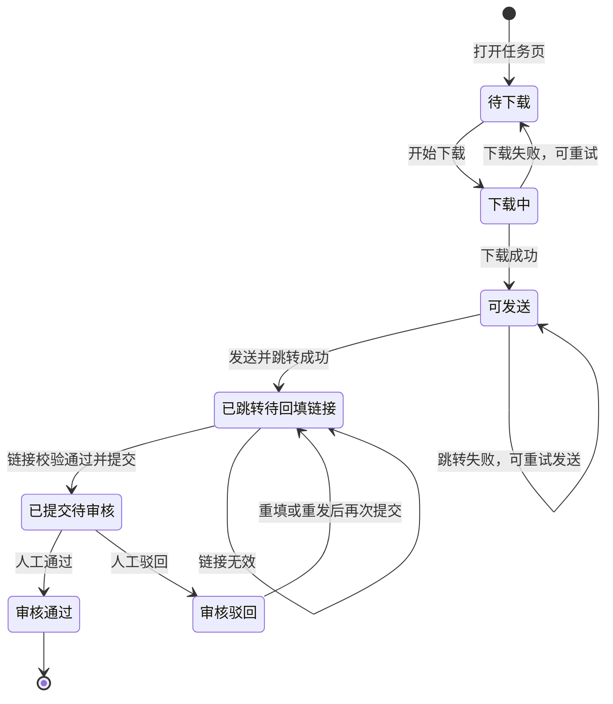

# PWA Partner「发布 Instagram 商品帖」产品说明

- 产品线：Sitin PWA 的 Partner 任务（首页「Become a partner」区块），不与 Onia 自动发帖、也不与 Verlume 混写。
- 成稿日期：2026-11-24。
- 状态：产品评审稿。本文只出方案，不开发、不改仓库。
- 目标飞书页（本文不直接写入，齐套后由飞书助手落页）：[Partner 相关 wiki](https://presence.feishu.cn/wiki/VWvHwUrBRii5AIk7V0QcUNDEnmf)
- 相关已有记录：[Partnership Ads · PWA 任务技术方案](partnership-ads-pwa.md)；[技术方案 / 实现方案](pwa-partner-instagram-product-post-tech.md)

## 1. 关键假设与对齐说明

本文所有标为「假设」的内容，实施前需与后端、客户端、运营确认；未标注的需求来自本次产品说明，或已与现有仓库/知识库对齐。

1. **命名假设**：需求原文为「PWA 的 pattner 任务」。按 **Partner** 理解，对应现有首页 Partner 区块（`PartnerAdsSection` / Become a partner），不是新的独立产品线。
2. **任务类型名称**：对外可称「发布 Instagram 商品帖」。已验证的发帖路径是 **Instagram Reel + Tag products（商品标签）**，不是 Feed 图文帖。文档与引导文案须写清这一点。
3. **taskid 假设**：建议新任务 id 为 **2006**，前端枚举名建议 `PartnerIgProductPost`。现有 Partner 系列已占用：2000 广告共创批准、2001–2003 在线时长、2004 主页链接推广；**2005** 已用作前端本地授权任务 `PartnerAuthorization`（后端不下发，但仍勿复用）。若服务端已另分配 id，以服务端为准，并回写本文。
4. **extra 字段命名假设**：`CommonTaskInfo.extra` 现为 `map<string, string>`，值全部是字符串。已有字段存在两套风格：在线时长用 camelCase（`onlineMs` / `targetMs` / `reached` / `agreed`），运营下发的内容链接用 snake_case（2004 的 `promote_url`）。本任务四项均为运营/服务端下发的内容，**建议与 `promote_url` 对齐，使用 snake_case**：`video_url`、`caption`、`product_name`、`shop_name`。若后端已定其它键名，前端按服务端键名解析，不在客户端改名。
5. **完成口径**：用户回填帖子链接并点击「完成」，只表示提交审核；**人工审核通过后才算任务完成**。不得在点击「完成」或刚跳转 Instagram 时直接当作已完成并发奖。
6. **界面建议（假设，作为本方案默认）**：采用 **独立任务页**，而不是底部抽屉。理由见第 5 节。
7. **端能力**：在现有 `bridge.ts` 中，已有 `openDeepLink`、`openSocialProxyWebView` 等，**未发现**「下载素材视频到相册」或「携带任务 extra 跳转发帖编辑页」的现成能力。本文第 7 节给出建议能力名与入参，需客户端新增，名称以客户端最终约定为准。
8. **审核接口**：现有 `finishUserCommonTask` 请求体只有 `task_id`，无法携带帖子链接，且调用语义是直接完成任务。本任务必须新增「提交审核」接口，禁止复用 `finishUserCommonTask` 来提交链接。
9. **平台范围**：发帖步骤已用 **iOS Instagram** 录屏证实。Android 纳入同一产品范围，但步骤与端能力表现未经验证，实施时需单独走查，不能把 iOS 录屏细节写成 Android 已证实。
10. **奖励金额、发放时效、日活与转化等数字**：需求未给，本文不编造。奖励展示沿用 `listAllCommonTasks` 返回的 `reward` 字段；发奖时机为审核通过且服务端将任务置为完成之后。
11. **查询策略**：沿用 Partner 既有约定——**不推送轮询审核结果、不在后台循环请求**。刷新发生在进入任务页、任务页回前台、用户手动刷新或再次提交之后。服务端状态为审核与完成的权威来源。
12. **下发频次**：需求未规定每日一次或一次性。假设由服务端通过 `listAllCommonTasks` 控制是否对用户可见；同一用户同一时间默认只处理一条未完成的本类任务。若需按 `biz_date` 每日重新下发，由服务端决定并在联调时确认。

## 2. 目标与范围

### 2.1 要解决的问题

Partner 用户需要按任务要求，在自己的 Instagram 账号发布一条带商品标签的 Reel：使用任务下发的视频、文案，并标签到指定店铺与商品。产品要提供清晰的发送步骤、可复制的发帖信息、可靠的视频下载与跳转，以及回填链接后的人工审核闭环。用户只提交链接不算完成，避免未按要求发帖却领到奖励。

### 2.2 范围内

- 服务端新增本类 common task（建议 taskid 2006），并在 `extra` 中携带视频链接、文案、商品名称、店铺名称。
- PWA 首页 Partner 区块展示该任务入口；用户点击后进入任务详情（独立页）。
- 详情中展示发送步骤，以及文案、商品名称、店铺名称，三者均可复制到剪贴板。
- 利用客户端能力下载素材视频；下载过程提示「视频下载中」；下载完成后才点亮「发送」。
- 用户点击「发送」后，PWA 把任务 `extra` 的**全部字段**传给客户端能力，由客户端再跳到 Instagram 发帖编辑相关页面。
- 用户按引导在 Instagram 内发帖；发完回到 PWA 填写帖子链接，点击「完成」提交服务端审核。
- 人工审核通过后任务才完成；驳回后可重试（重填链接，或按需重新下载/重新跳转发送）。
- 覆盖下载失败、跳转失败、链接无效、审核驳回等异常与缺失态。

### 2.3 非目标（本阶段不做）

- 不通过 Social Proxy / Onia 自动代发，不绕过用户在 Instagram 里的手动操作。
- 不改现有 2000–2005 的主流程，不把本任务塞进 2004 的「Go → 回前台自动校验」模型。
- 不验证、不要求站外购买或站外下单（录屏未验证，不得写成已验证能力或审核项）。
- 不在本文或实现说明中写入任何出图接口、密钥、签名或内部凭证。
- 不规定素材视频的生产来源（只消费 `extra.video_url`）。
- 不在本阶段设计运营后台的审核工作台细节；只约定审核结论如何回传 PWA，以及审核员应核对的规则。
- 不把 Feed 图文、Story、Reels 配乐/滤镜/额外剪辑写成必做步骤（录屏中未见这些操作）。

## 3. 用户故事

1. **作为 Partner 用户**，我想在任务里直接看到要发的文案、商品名和店铺名，并能一键复制，以免在 Instagram 里手工记忆或抄错。
2. **作为 Partner 用户**，我想在发送前先把指定视频下到手机相册，并明确知道「正在下载」还是「已经可以发送」，以免跳转到 Instagram 后找不到素材。
3. **作为 Partner 用户**，我想按页面上的步骤，在 Instagram 用 Reel 发布该视频、标签指定商品、粘贴指定文案，再回到 PWA 交帖子链接。
4. **作为 Partner 用户**，我想在审核未通过时看到原因，并能重新提交或重新走发送流程，而不是任务直接消失或被锁死。
5. **作为审核人员**，我想根据用户提交的帖子链接，核对是否按要求发布了带商品标签的 Reel，只有通过才把任务标为完成。

## 4. 主流程与关键状态

### 4.1 主流程

1. 服务端向符合条件的用户下发本任务；`listAllCommonTasks` 中带有建议 id 2006，以及第 6 节规定的 `extra`。
2. 用户在首页 Partner 区块看到任务卡，点击「去完成」（界面文案假设见第 5.3 节）进入独立任务页。
3. 任务页展示步骤、可复制字段；进入页面后自动开始下载 `extra.video_url` 到系统相册。按钮区显示「视频下载中」，「发送」不可用。
4. 下载成功后，「发送」点亮。下载失败则保持不可发送，并提供重试下载。
5. 用户点击「发送」。PWA 调用客户端「跳转发帖编辑页」能力，**入参必须是该任务 extra 的全部字段**（原样透传，不得只传部分键）。客户端完成处理后跳转 Instagram。
6. 用户按第 8 节步骤在 Instagram 发帖，并确认商品标签可见、可打开商品详情卡。
7. 用户回到 PWA 任务页（此时为「已跳转待回填链接」），粘贴帖子链接，点击「完成」。
8. PWA 先做链接格式校验；通过后调用服务端提交审核接口，进入「已提交待审核」。
9. 人工审核通过后，服务端将任务置为完成并发奖（若该任务配置了奖励）；PWA 在下次刷新时展示完成态。审核驳回则回到可重试，并展示驳回原因。

从 PWA 跳到 Instagram 期间，套壳 WebView 可能被回收。任务页的本地阶段（至少包括：已发起下载/下载成功/已点击发送）须持久化；**审核与是否完成以服务端为准**。页面重建后，若无法可靠确认相册中仍有该视频，应重新下载，「发送」在再次成功前保持熄灭。

### 4.2 状态定义

以下为产品状态，需在任务页与任务卡上可感知。括号内为建议的服务端/本地分层。

| 产品状态 | 含义 | 权威来源 | 主按钮与展示 |
|---|---|---|---|
| 待下载 | 已进入任务，尚未成功把视频下到相册 | 本地 | 自动或手动开始下载；「发送」禁用 |
| 下载中 | 正在下载视频 | 本地 / 端能力回调 | 展示「视频下载中」；「发送」禁用；不可重复触发下载 |
| 可发送 | 视频已在相册，可以跳转 | 本地 | 「发送」点亮 |
| 已跳转待回填链接 | 已成功调起跳转（或用户声明已去发帖），等待粘贴帖子链接 | 本地阶段 + 服务端仍未提交 | 展示链接输入框与「完成」；允许再次发送 |
| 已提交待审核 | 链接已提交，人工尚未给出结论 | 服务端 | 「完成」不可重复提交；展示审核中；允许查看已提交链接 |
| 审核通过 | 审核通过，任务完成 | 服务端 | 任务完成；按既有 Partner 规则展示奖励并隐藏或收起任务卡 |
| 审核驳回（可重试） | 审核未通过 | 服务端 | 展示原因；可改链接再提交，也可重新下载/重新发送后再提交 |

状态流转：

说明：

- 「已跳转待回填链接」在跳转失败时不得进入。只有客户端能力返回成功，或产品约定的成功回调到达后，才进入该状态。
- 进入「已跳转待回填链接」后，仍保留「发送」，方便用户没发成或需要重发。
- 「已提交待审核」期间，默认不允许再点「完成」重复提交；若用户发现链接填错，须等驳回后再改，或由后续确认是否允许「撤回并重提」。**本方案默认：待审核中不可撤回，不可改链接。**（假设，待确认）
- 前端现有 `TaskStatus` 仅有 `notStart` / `finish`。本任务的「待审核 / 驳回」不能只靠这两个值区分。假设由新审核接口与任务查询回包携带审核状态；不要把待审核误写成 `finish`，否则会重现 2000 任务曾出现的「PENDING 被当成已完成而隐藏卡片」问题。

## 5. 信息架构

### 5.1 入口与页面

- **任务卡**：放在首页 Partner 区块，与 2000 / 2001–2003 / 2004 / 授权卡并列，不进入通用日常任务列表冒充普通任务。
- **任务详情（推荐，默认方案）**：独立路由页。由任务卡「去完成 / 继续」进入。承担步骤、复制区、下载与发送、链接回填、审核态与重试。
- **不建议作为默认的方案**：底部抽屉。现有授权告知（2005）用抽屉是合适的，因为那是一次性阅读并勾选同意。本任务是跨应用、可中断、需回填和等待审核的长流程；跳转 Instagram 时 WebView 可能被回收，抽屉更容易丢失。若设计坚持用抽屉，也必须全屏高度、完成前谨慎关闭，并与独立页同等做状态持久化——即便如此，仍建议用独立页。

### 5.2 任务页结构（自上而下）

1. 标题与奖励（奖励文案来自任务 `reward`，无则不展示金额）。
2. **发送步骤**：按第 8 节通用描述展示，逐步、可扫读。步骤里的店铺名、商品名、文案必须引用当前任务 `extra`，不能写死录屏示例。
3. **待复制信息**：文案、商品名称、店铺名称，每项一行，带复制按钮。复制成功给短反馈。视频链接不对用户提供复制（视频走下载，不靠用户手工取链）。
4. **发送区**：下载状态文案 +「发送」按钮。未下载成功时按钮禁用，并显示「视频下载中」或失败原因 +「重试下载」。
5. **帖子链接区**：在首次成功跳转之后出现（或审核驳回后再次出现）。输入框 +「完成」。
6. **审核结果区**：待审核提示，或通过，或驳回原因 + 重试说明。

任务卡在各阶段的建议：

- 未开始或下载/发送中：主按钮为「去完成」，进入任务页。
- 已跳转待回填：主按钮为「继续」，进入后落在链接区。
- 待审核：按钮为「审核中」，可进入查看，不可再提交。
- 驳回：按钮为「重试」，进入后展示原因。
- 通过/完成：按 Partner 既有完成态处理（2004 完成后卡片自隐）。不要用本地猜测提前隐藏。

### 5.3 界面文案假设

现有 Partner 区块主要是英文（Become a partner、Go、Received、Claim）。本任务对用户可见的文案 **默认用英文**，与该区块保持一致；中文是产品说明语言。以下为假设，设计可改，但语义不能改。

| 位置 | 建议英文文案 | 语义 |
|---|---|---|
| 任务卡标题 | Post an Instagram product Reel | 发布带商品标签的 Reel |
| 主按钮 | Go / Continue / In review / Retry | 去完成 / 继续 / 审核中 / 重试 |
| 下载中 | Downloading video… | 视频下载中 |
| 发送 | Post | 发送（跳转发帖） |
| 复制 | Copy | 复制到剪贴板 |
| 链接占位 | Paste your Instagram Reel link | 粘贴帖子链接 |
| 提交 | Complete | 完成（提交审核） |
| 待审核 | Your post is under review | 已提交待审核 |
| 驳回 | Review didn’t pass | 审核驳回，可重试 |

## 6. 待复制字段与 extra 约定

### 6.1 服务端下发

任务走既有 `listAllCommonTasks`。`CommonTaskInfo` 已有 `task_id`、`title`、`reward`、`extra`（`map<string, string>`）、以及列表级 `biz_date`。本任务新增一条记录，建议 `task_id = 2006`。

`extra` **至少**包含：

| 键（假设） | 含义 | 展示与使用 |
|---|---|---|
| `video_url` | 素材视频地址 | 仅用于客户端下载，不在复制区展示，不要求用户复制 |
| `caption` | 发帖文案 | 展示 + 复制；用户在 Instagram 说明（caption）中使用 |
| `product_name` | 商品名称 | 展示 + 复制；用户在 Tag products 时勾选同名商品 |
| `shop_name` | 店铺名称 | 展示 + 复制；用户在 Tag products 时选择对应店铺 |

约束：

- 四个字段均不能为空。任一缺失则进入第 10 节「任务数据缺失」，不允许开始下载或发送。
- 值按字符串存储。不要在文档或协议里假设其中藏有密钥、签名或出图参数。
- PWA 展示与复制使用字段的原始文本，不做自动翻译、不擅自改商品名或店铺名。
- 复制能力复用现有剪贴板工具（当前 Partner 2004 已用 `copyToClipboard` 复制 `promote_url`），需兼容套壳 WebView。

### 6.2 透传规则

调用「跳转发帖编辑页」时，必须把**当前任务 extra 的全部键值**交给客户端能力，而不是只传上面四个键。这样服务端以后新增字段（例如货币、商品外部 id）时，不必先改 PWA 的白名单才能到达客户端。PWA 不得丢字段、不得改键名、不得把空值键悄悄删掉（若服务端显式给了空字符串，原样传递；但按 6.1，四个必填项为空则根本不应调用该能力）。

### 6.3 录屏数据仅作示例

2026-11-24 的 iOS 录屏里出现过：账号 `zhangzifanss`、店铺 `sitin.ai_official`、商品 `Cable-Knit V-Neck Cardigan`（标价 HK$118）、文案 `Great`。这些 **不是协议字段，不得写死在任务页或步骤模板里**。正式下发以当次任务 `extra` 为准。标价未进入本次必填 `extra`，审核也不以价格为通过条件，除非以后单独增加字段并另行评审。

## 7. 客户端能力约定

PWA 在套壳 WebView 中无法可靠完成「把远程视频存进系统相册」和「跳转 Instagram 发帖编辑页」。这两步必须走客户端能力。下列名称是建议，需与客户端对齐后回写。

### 7.1 下载素材视频

- 建议能力名：`downloadVideoToAlbum`。
- 建议入参：至少包含 `url`（取 `extra.video_url`）。为减少后续扩展，允许同时传入完整 `extra`，但下载地址必须以 `video_url` 为准。
- 行为：将视频保存到系统相册，以便用户在 Instagram 发 Reel 时「从相册选择」。
- 进度：调用后 PWA 立即进入「下载中」并展示「视频下载中」。客户端须回调或返回明确的开始、成功、失败。成功后才允许点亮「发送」。不要求在 PWA 上展示精确百分比（未作为需求）；若客户端能给进度，可作为增强，但成功/失败是必需要素。
- 失败：返回可展示的失败原因（权限拒绝、网络失败、地址无效、存储失败等）。PWA 提供「重试下载」。不要在失败时点亮「发送」。
- 权限：若系统相册/存储权限未授予，客户端应触发系统授权；用户拒绝则按下载失败处理，并提示需要相册权限。
- 幂等：同一 `video_url` 重复下载，允许覆盖或跳过已存在文件，但必须再次给出成功或失败结论，不能让 PWA 一直停在「下载中」。

### 7.2 跳转发帖编辑页

- 建议能力名：`openInstagramProductPostEditor`。
- **入参：任务 extra 的全部字段。** 这是硬性约定。PWA 把 `extra` 原样传入；客户端可以按需使用其中字段（例如预填或辅助跳转），但协议层不得要求 PWA 先筛一遍。
- 行为：由客户端处理完必要动作后，跳转到 Instagram。能落到更接近发帖编辑的页面更好；若系统或 Instagram 只能打开至创建入口，也须跳转成功，后续步骤仍按第 8 节由用户完成。具体落地页以客户端实现为准，本文不把某一个深层 deeplink 写成已验证事实。
- 返回：必须有成功 / 失败。只有成功才进入「已跳转待回填链接」。失败时停留在「可发送」，展示原因，允许重试「发送」。视频下载状态保持成功，不必强制重新下载。
- 与现有 `openDeepLink` 的关系：2000 / 2004 使用 `openDeepLink` 打开固定 deeplink，不携带 extra。本任务 **不要只用 `openDeepLink` 打开一个不含 extra 的固定链接** 来代替本能力，否则「必须把 extra 全部字段发给该客户端能力」无法满足。

### 7.3 调用时序

1. 先下载成功，再允许发送。
2. 发送只调用跳转能力，不在此时提交审核，也不调用 `finishUserCommonTask`。
3. 跳转与审核解耦：跳转成功不等于发帖成功，更不等于任务完成。

## 8. 发送步骤（写入产品说明的已证实路径）

步骤必须用通用描述。方括号中的内容来自任务 `extra`。录屏细节只放在本节末尾示例，不进入用户步骤正文。

推荐步骤文案（产品说明与任务页共用结构）：

1. 打开 Instagram，确认当前登录的是要完成任务的账号。
2. 在主页点击底部「＋」，选择 **Reel**（不是普通帖、也不是 Story）。
3. 从相册选择刚刚下载的任务视频，点击 Next。无需额外剪辑、滤镜或配乐（这些不是本任务要求）。
4. 点击 Tag products（标签商品）。在店铺列表中找到并选择任务给出的店铺「[shop_name]」。若列表未直接出现，可搜索该店铺名（搜索是否可用以 Instagram 当时界面为准，录屏走的是 Suggested shops，搜索未单独证实）。
5. 勾选名称与「[product_name]」一致的商品，确认后完成标签。
6. 在说明（caption）中输入任务文案「[caption]」。建议直接粘贴，不要自行改写（除非运营另有说明）。
7. 点击 Share，等待发布完成（出现 Posting / Posted 或等价完成提示）。
8. 回到主页打开刚发布的 Reel，确认画面上能看到商品标签；点击标签应能打开商品详情卡。
9. 复制该 Reel 的链接，回到本任务页粘贴，并点击「完成」提交审核。

已证实的录屏复盘（2026-11-24，**仅作示例**，可写进说明，不可当作固定配置）：

- 平台与账号：iOS Instagram，示例账号 `zhangzifanss`。
- 路径：主页底部「＋」→ Reel → 相册选视频 → Next。录屏中未见额外剪辑、滤镜、配乐。
- 标签：Tag products → Suggested shops 中选择 `sitin.ai_official` → 勾选 `Cable-Knit V-Neck Cardigan`（示例标价 HK$118）→ Done (1)。
- 文案与发布：caption 输入 `Great` → Share → 等待 Posting / Posted to zhangzifanss。
- 回访校验：回主页打开新 Reel，左下角可见商品标签，点击可打开商品详情卡。
- **录屏未验证站外购买。不得把站外下单、站外支付写成已验证步骤或审核项。**

## 9. 审核接口与人工审核规则

### 9.1 提交审核接口（假设）

建议新增服务端接口（名称待后端确定，本文称为「提交 Partner 商品帖审核」），由任务页点击「完成」时调用。

建议请求：

- `task_id`：本任务 id（建议 2006）
- `post_url`：用户填写的 Instagram 帖子 / Reel 链接

建议响应至少区分：

- 已受理，进入待审核
- 链接无效或无法识别，不进入审核（任务仍停在待回填）
- 当前已在待审核，拒绝重复提交
- 任务已完成，无需再提交
- 其它失败（网络或服务错误），用户可重试提交，不丢失已填链接

约束：

- **不要**用现有 `finishUserCommonTask(task_id)` 提交链接。它不能带 URL，且成功即完成任务，会跳过人工审核。
- 审核通过后，由**服务端**将用户任务置为完成，再按既有发奖机制发奖。PWA 通过刷新 `listAllCommonTasks` / 用户任务状态看到 `finish`，再走既有奖励弹窗（若该任务登记了奖励弹窗）。
- PWA 不轮询。用户停留在任务页或从后台回到该页时各刷新一次；任务卡再次进入也可刷新。
- 查询结果须能区分：未提交、待审核、通过、驳回（含原因文案）。驳回原因需要能展示给用户。字段名由后端定义，本文不编造。

### 9.2 链接校验（提交前）

PWA 先做浅校验，服务端再做权威校验。浅校验失败不发请求。

假设可接受的链接形态包括：

- `https://www.instagram.com/reel/...`
- `https://www.instagram.com/p/...`
- `https://instagram.com/...` 以及带 `www` / 地区子域 / 末尾查询参数的常见变体

空字符串、明显不是 Instagram 帖子的链接（例如主页、店铺页、随便一段文字）视为无效。短链若无法在客户端判定，交给服务端判断；服务端认为无效时，状态仍为待回填，并提示用户改链接。

### 9.3 人工审核规则

审核员依据用户提交的链接打开该 Instagram 内容，核对下列事项。全部满足才可通过。

1. 链接可打开，内容是已发布的视频 Reel（或等价的已发布视频帖），不是草稿、不是仅自己可见的未发布内容。
2. 发布账号为该用户用于完成本任务的 Instagram 账号。若账号绑定信息可用于辅助判断则使用；否则人工核对。
3. 画面上有商品标签；点击标签能打开商品详情卡。此项已由录屏证实为可检查项。
4. 所标店铺名称与任务 `shop_name` 一致。
5. 所标商品名称与任务 `product_name` 一致。
6. 帖子说明与任务 `caption` 一致。默认按全文一致核对（可忽略首尾空格）。若运营允许改写，需另作说明后再放宽，本文不默认放宽。
7. **不审核站外购买、站外下单或支付是否发生。**

驳回时必须给出原因，建议归类以便前端展示，例如：链接无法打开、不是 Reel / 未见该帖、未见商品标签、店铺不符、商品不符、文案不符、账号不符。具体枚举由后端与运营确定。

审核时效、抽检比例、是否抽查历史帖等运营指标，需求未给，本文不规定数字。

## 10. 异常与缺失态

| 情况 | 表现 | 处理 |
|---|---|---|
| `extra` 缺少 `video_url` / `caption` / `product_name` / `shop_name`，或值为空 | 任务页展示数据不完整，不自动下载 | 不点亮「发送」；提示任务信息不完整，请稍后再试或联系支持。不要用录屏示例值填空 |
| 下载失败（网络、地址失效、写相册失败） | 「发送」保持禁用；展示失败原因 | 提供「重试下载」；可保留已展示的文案与步骤 |
| 相册 / 存储权限拒绝 | 同下载失败 | 提示需要相册权限，引导用户授权后重试 |
| 下载中断（进程被杀、WebView 回收） | 恢复后不得假装已成功 | 若不能确认相册已有该视频，重新下载 |
| 跳转失败（未装 Instagram、能力不存在、客户端返回失败） | 留在「可发送」 | 展示失败原因，保留「发送」可重试；不进入待回填 |
| 用户跳转后未发帖就返回 | 已进入待回填，但还没有有效链接 | 允许稍后填写；也允许再次发送。不自动提交、不自动完成 |
| 链接为空或格式无效 | 「完成」可点，但提交被拦截 | 提示链接无效，保持待回填 |
| 提交审核接口失败 | 不进入待审核 | 保留已填链接，允许重试「完成」 |
| 待审核中再次点击完成 | 不重复建单 | 提示已在审核中 |
| 审核驳回 | 展示原因，任务未完成 | 可修改链接后再次提交；也可重新下载或重新发送后再提交。奖励不发 |
| 审核通过但奖励弹窗未出现 | 任务已是完成态 | 以服务端完成态为准；奖励按既有 finish 后的弹窗机制，不在本文另造一套发奖 |
| 非套壳环境 / 端能力不可用（例如纯浏览器） | 无法下载或无法跳转 | 明确提示需在 App 内完成，不降级成「只复制链接让用户自己想办法下载」而不告知限制。是否提供手动保存指引待确认；默认不把纯 H5 当作已支持路径 |

## 11. 验收标准

下列每条均需可测。未经验证的 Android 细节不作为「已通过 iOS 录屏」的自动继承项，Android 需单独验收。

1. 服务端能为本类任务分配独立 taskid（建议 2006），且 `listAllCommonTasks` 返回的 `extra` 含 `video_url`、`caption`、`product_name`、`shop_name`（或已确认的等价键名）。
2. 首页 Partner 区块出现该任务入口；点击进入独立任务页（若改用抽屉，须单独评审，并仍满足状态持久化）。文档默认按独立页验收。
3. 任务页展示发送步骤；步骤中的文案、商品名、店铺名来自当前 `extra`，而不是录屏示例写死。
4. 文案、商品名称、店铺名称均可单独复制到剪贴板，内容与 `extra` 原文一致。
5. 进入任务页后自动开始下载视频；下载过程中固定展示「视频下载中」（或第 5.3 节对应英文），「发送」不可用。
6. 下载成功后「发送」点亮；失败时不点亮，且可以重试下载。
7. 点击「发送」时，客户端能力收到的是该任务 **extra 全部字段**，不得缺失已下发的键。之后才跳转 Instagram。
8. 跳转失败时不进入待回填，下载成功态保留，可重试发送。
9. 按第 8 节步骤在 iOS Instagram 发布后，用户可在任务页提交 Reel 链接；浅校验拦截明显无效链接。
10. 点击「完成」只调用提交审核接口，不调用 `finishUserCommonTask`，任务此时未完成、不发奖。
11. 待审核状态下任务卡与任务页展示审核中；刷新后状态保持，不会被误标为已完成而隐藏。
12. 人工按第 9.3 节通过后，任务变为完成，此后才允许发奖/完成态展示。
13. 驳回后展示原因，用户可以重填链接或重新发送后再提交；再次提交前任务仍未完成。
14. 跳转 Instagram 导致 WebView 被回收后，重新打开任务页能恢复到合理阶段，且不会在未确认下载成功时点亮「发送」。
15. 文档、任务说明与审核规则均未把站外购买写成已验证要求。
16. 实现与文档中均不出现出图接口、密钥或签名材料。

## 12. 待确认问题

1. 服务端最终 taskid 是否采用 2006，枚举名是否采用 `PartnerIgProductPost`。
2. `extra` 四字段是否采用本文建议的 snake_case 键名。
3. 提交审核接口的实际路径、字段与驳回原因枚举。
4. 待审核期间是否允许撤回或修改链接（本文默认不允许）。
5. 客户端两项能力的最终方法名、回调协议，以及跳转后实际落到 Instagram 的哪一个页面。
6. 本任务是一次性、按 `biz_date` 每日一条，还是由运营按需下发。
7. 奖励是否登记既有奖励弹窗，以及审核通过后的发奖是否完全由服务端在置完成时处理。
8. Android 的下载、相册权限与跳转路径何时走查。
9. 任务页对用户可见文案是否确认用英文，以与现有 Partner 区块一致。
10. 纯浏览器 / 无端能力时，是否只提示去 App 完成，不做 H5 降级。

## 13. 本文未改动的相邻能力

2000 广告共创批准、2001–2003 在线时长、2004 主页链接（`extra.promote_url` + `instagram://editprofile`）、本地授权 2005，均保持原流程。本任务只在 Partner 区块新增一类入口和独立详情，不要求改 Onia 仓库，也不把自动 `create_post` 当作本需求的实现路径。
